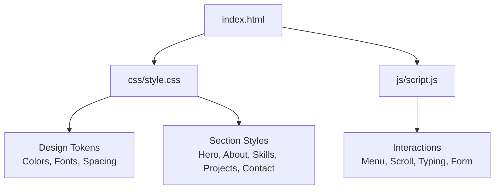
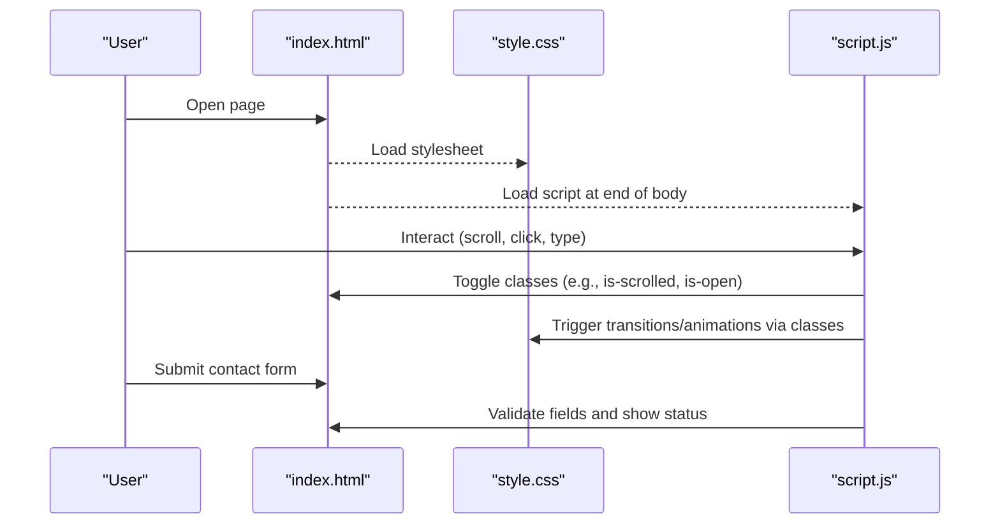
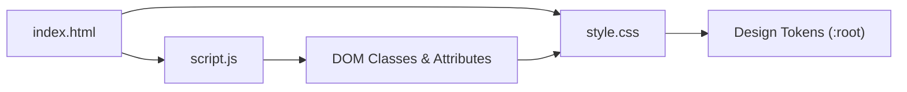

# Customization Guide

<cite>
**Referenced Files in This Document**
- [index.html](file://index.html)
- [style.css](file://css/style.css)
- [script.js](file://js/script.js)
</cite>

## Table of Contents
1. [Introduction](#introduction)
2. [Project Structure](#project-structure)
3. [Core Components](#core-components)
4. [Architecture Overview](#architecture-overview)
5. [Detailed Component Analysis](#detailed-component-analysis)
6. [Dependency Analysis](#dependency-analysis)
7. [Performance Considerations](#performance-considerations)
8. [Troubleshooting Guide](#troubleshooting-guide)
9. [Conclusion](#conclusion)
10. [Appendices](#appendices)

## Introduction
This guide explains how to customize the portfolio website’s theme, content, and behavior. You will learn how to:
- Customize colors, fonts, spacing, and design tokens using CSS custom properties
- Add new sections by following existing HTML patterns and corresponding CSS styles
- Modify personal information, project details, skills, and contact form fields
- Extend JavaScript features such as animations, interactions, and additional functionality
- Follow best practices for maintainable, consistent customization

The site is built with semantic HTML, a single stylesheet organized around design tokens, and vanilla JavaScript for interactivity.

## Project Structure
The repository contains three main files:
- index.html: page structure and content
- css/style.css: all styling, including design tokens and responsive rules
- js/script.js: interactive behaviors like menu toggling, scroll effects, typing animation, and form validation

**Diagram sources**
- [index.html:1-540](file://index.html#L1-L540)
- [style.css:1-1508](file://css/style.css#L1-L1508)
- [script.js:1-388](file://js/script.js#L1-L388)

**Section sources**
- [index.html:1-540](file://index.html#L1-L540)
- [style.css:1-1508](file://css/style.css#L1-L1508)
- [script.js:1-388](file://js/script.js#L1-L388)

## Core Components
Key areas you will customize most often:
- Design tokens (colors, fonts, spacing, motion)
- Sections (hero, about, skills, projects, contact)
- Interactive behaviors (menu, reveal-on-scroll, typing effect, form validation)

How to approach customization:
- Start with design tokens to establish your brand palette and typography
- Update content in the relevant section blocks in HTML
- Adjust component styles only when necessary; prefer token-driven changes
- Extend JS features carefully, keeping accessibility and performance in mind

**Section sources**
- [style.css:25-73](file://css/style.css#L25-L73)
- [index.html:21-540](file://index.html#L21-L540)
- [script.js:18-388](file://js/script.js#L18-L388)

## Architecture Overview
High-level flow of how the site works:
- The HTML defines sections and components
- The CSS applies design tokens and styles across components
- The JS enhances UX with scroll-based behaviors, animations, and form handling

**Diagram sources**
- [index.html:1-540](file://index.html#L1-L540)
- [style.css:1-1508](file://css/style.css#L1-L1508)
- [script.js:18-388](file://js/script.js#L18-L388)

## Detailed Component Analysis

### Theme Customization with CSS Custom Properties
The theme is controlled through CSS variables defined in the root scope. Change these values to update colors, fonts, spacing, gradients, and motion globally.

What to customize:
- Backgrounds and surfaces: --bg, --bg-soft, --surface, --surface-2
- Borders: --border, --border-strong
- Text: --text, --text-muted, --text-dim
- Brand colors: --primary, --primary-light, --accent, --accent-soft, --pink, --success, --danger, --warning
- Gradients: --gradient, --gradient-soft, --gradient-text
- Shape and depth: --radius-sm, --radius, --radius-lg, shadows
- Typography: --font-body, --font-heading
- Layout: --container, --header-height
- Motion: --ease, --speed

Steps:
1. Open css/style.css and locate the :root block
2. Replace color values with your brand palette
3. Swap font families if needed
4. Adjust radii and shadows to match your design system
5. Tweak easing and speed for consistent motion

Best practices:
- Keep contrast ratios accessible after changing text and background colors
- Use consistent naming and grouping for clarity
- Test on light/dark backgrounds if you plan to support both modes later

**Section sources**
- [style.css:25-73](file://css/style.css#L25-L73)

### Adding New Sections
To add a new section:
1. Create a new <section class="section"> or <section class="section section-alt"> in index.html
2. Add a container div and a section-head with eyebrow, title, and subtitle
3. Place your content inside the section
4. If it should animate on scroll, add class="reveal" to elements that should fade in
5. Add a navigation link in the header nav-menu pointing to the new section id
6. Optionally add responsive adjustments in style.css under media queries

Example pattern:
- Section wrapper: <section class="section" id="your-section">
- Container: 

- Head: 
...

- Content: grid or flex layout as needed
- Footer links: add an anchor in footer-links

Notes:
- Use section-alt for alternating backgrounds
- Ensure the section has a unique id for navigation
- Keep content accessible with proper headings and labels

**Section sources**
- [index.html:156-226](file://index.html#L156-L226)
- [index.html:231-327](file://index.html#L231-L327)
- [index.html:332-420](file://index.html#L332-L420)
- [index.html:425-511](file://index.html#L425-L511)
- [style.css:276-316](file://css/style.css#L276-L316)

### Modifying Personal Information
Update your name, role, bio, location, and social links:
- Hero: change the greeting, title, subtitle, description, and social links
- About: edit paragraphs and facts list
- Contact: update email, location, response time, and call-to-action note

Where to look:
- Hero content: lines around the hero-title, hero-subtitle, hero-description, and socials list
- About content: about-text paragraphs and about-facts list
- Contact info: contact-info items and contact-note

Tips:
- Keep tone consistent across sections
- Use meaningful aria-labels for social icons
- Link to real profiles and ensure external links use target="_blank" and rel="noopener"

**Section sources**
- [index.html:57-151](file://index.html#L57-L151)
- [index.html:156-226](file://index.html#L156-L226)
- [index.html:425-511](file://index.html#L425-L511)

### Changing Project Details
Each project card includes:
- Thumbnail area with optional badge and glyph
- Body with title, description, tags, and links

To modify:
- Update the h3 title and p description
- Edit the tags list
- Set href attributes for Live Demo and Source Code
- Optionally add a featured badge to highlight a project

To add a new project:
- Duplicate an existing article.project-card
- Update the thumbnail class (thumb-1/2/3) or create a new one
- Fill in the body content and links

Styling notes:
- Thumbnails use gradient backgrounds; you can add new thumb-N classes in CSS
- Tags are styled with accent colors; keep them concise

**Section sources**
- [index.html:332-420](file://index.html#L332-L420)
- [style.css:871-1017](file://css/style.css#L871-L1017)

### Adding New Skills
Skills are presented as cards with:
- Icon, title, percentage label
- Description
- Progress bar animated by JS based on data-width

To add a skill:
- Duplicate a skill-card article
- Update icon SVG, title, description, and data-width
- Ensure the progress bar reflects the correct percentage

To adjust existing skills:
- Change the percent label and data-width to reflect proficiency
- Update descriptions to match current expertise

Accessibility:
- Each progress container uses role="progressbar" and aria attributes
- Keep aria-valuenow matching the actual width

**Section sources**
- [index.html:231-327](file://index.html#L231-L327)
- [style.css:790-869](file://css/style.css#L790-L869)
- [script.js:133-151](file://js/script.js#L133-L151)

### Extending the Contact Form
The contact form includes:
- Fields: name, email, subject, message
- Inline validation with error messages
- Status message on submit

To extend:
- Add a new field in HTML with a label, input, and error span
- Register the field in script.js fields map with validate function
- Style any new inputs using existing .field styles

Validation tips:
- Provide clear, user-friendly error messages
- Use appropriate input types and autocomplete attributes
- Respect reduced-motion preferences where applicable

Backend integration:
- Replace the simulated send with fetch() to a service like Formspree or your server
- Handle success/error states and provide feedback

**Section sources**
- [index.html:475-508](file://index.html#L475-L508)
- [style.css:1093-1169](file://css/style.css#L1093-L1169)
- [script.js:243-346](file://js/script.js#L243-L346)

### Customizing JavaScript Functionality
Common enhancements:
- Add new animations: define keyframes in CSS and trigger via classes in JS
- Modify interaction behaviors: attach event listeners to new elements
- Integrate additional features: analytics, chat widgets, or third-party scripts

Key areas:
- Sticky header and back-to-top visibility
- Mobile menu toggle and accessibility attributes
- Active nav link tracking via IntersectionObserver
- Reveal-on-scroll animations
- Skill bars animation
- Number counting animation
- Typing effect in hero
- Contact form validation and submission simulation
- Mouse-follow glow effect

Extending safely:
- Wrap new code in the IIFE to avoid global conflicts
- Respect prefers-reduced-motion and hover/pointer capabilities
- Debounce or throttle expensive events if needed

**Section sources**
- [script.js:18-388](file://js/script.js#L18-L388)
- [style.css:1245-1300](file://css/style.css#L1245-L1300)

### Step-by-Step Examples

#### Example 1: Change Brand Colors
- Open css/style.css
- In :root, update --primary, --accent, and related gradient variables
- Save and refresh to see updated buttons, accents, and highlights

#### Example 2: Add a Portfolio Section
- Insert a new <section class="section" id="portfolio"> in index.html
- Add a container, section-head, and a grid of portfolio items
- Add a nav link in the header pointing to #portfolio
- Add reveal classes to items for scroll animations

#### Example 3: Update Your Name and Role
- In index.html, change the hero-title and hero-subtitle
- Update the typed roles array in script.js to include your new titles
- Refresh to see the typing effect reflect changes

#### Example 4: Add a New Social Link
- In index.html, add a new li.socials item with an icon SVG and href
- Ensure aria-label describes the platform
- Optionally add hover styles in CSS if needed

#### Example 5: Extend Contact Form with Phone Field
- Add a phone input field in HTML with label and error span
- Register the field in script.js fields map with a phone validation rule
- Style the new field using existing .field styles

**Section sources**
- [style.css:25-73](file://css/style.css#L25-L73)
- [index.html:40-49](file://index.html#L40-L49)
- [index.html:57-151](file://index.html#L57-L151)
- [script.js:191-241](file://js/script.js#L191-L241)
- [index.html:475-508](file://index.html#L475-L508)
- [script.js:243-346](file://js/script.js#L243-L346)

## Dependency Analysis
Relationships between files and modules:
- index.html depends on css/style.css for presentation and js/script.js for behavior
- style.css defines tokens used throughout components
- script.js manipulates DOM classes and attributes to drive CSS transitions and animations

**Diagram sources**
- [index.html:1-540](file://index.html#L1-L540)
- [style.css:25-73](file://css/style.css#L25-L73)
- [script.js:18-388](file://js/script.js#L18-L388)

**Section sources**
- [index.html:1-540](file://index.html#L1-L540)
- [style.css:1-1508](file://css/style.css#L1-L1508)
- [script.js:1-388](file://js/script.js#L1-L388)

## Performance Considerations
- Prefer CSS variables for theme changes to minimize reflows
- Use IntersectionObserver for scroll-triggered animations instead of scroll event handlers
- Avoid heavy animations on low-power devices; respect prefers-reduced-motion
- Keep images minimal; this site uses SVGs and CSS gradients for visuals
- Defer non-critical scripts and place JS at the end of the body

[No sources needed since this section provides general guidance]

## Troubleshooting Guide
Common issues and fixes:
- Menu not opening on mobile:
  - Ensure the nav-toggle button exists and has the correct id
  - Check that JS attaches click listeners to the toggle
- Active nav link not updating:
  - Verify each section has a unique id
  - Confirm IntersectionObserver is observing sections
- Typing effect not appearing:
  - Check that the typed element exists and prefers-reduced-motion is not blocking it
- Form validation errors not showing:
  - Ensure field ids and error spans exist
  - Confirm the fields map in JS matches the HTML ids
- Animations too slow or fast:
  - Adjust --speed and --ease in :root
  - Tune transition durations in specific components

**Section sources**
- [script.js:36-81](file://js/script.js#L36-L81)
- [script.js:83-112](file://js/script.js#L83-L112)
- [script.js:191-241](file://js/script.js#L191-L241)
- [script.js:243-346](file://js/script.js#L243-L346)
- [style.css:25-73](file://css/style.css#L25-L73)

## Conclusion
You now have a complete roadmap to customize this portfolio site:
- Define your brand with CSS custom properties
- Add and modify sections following established patterns
- Update personal information, projects, and skills
- Extend JavaScript features thoughtfully while preserving accessibility and performance
- Maintain consistency and organization for long-term maintainability

[No sources needed since this section summarizes without analyzing specific files]

## Appendices

### Quick Reference: Where to Edit
- Theme tokens: css/style.css :root block
- Header and navigation: index.html header/nav
- Hero content: index.html hero section
- About content: index.html about section
- Skills: index.html skills section
- Projects: index.html projects section
- Contact: index.html contact section
- Footer: index.html footer
- Interactions: js/script.js

**Section sources**
- [style.css:25-73](file://css/style.css#L25-L73)
- [index.html:21-540](file://index.html#L21-L540)
- [script.js:18-388](file://js/script.js#L18-L388)