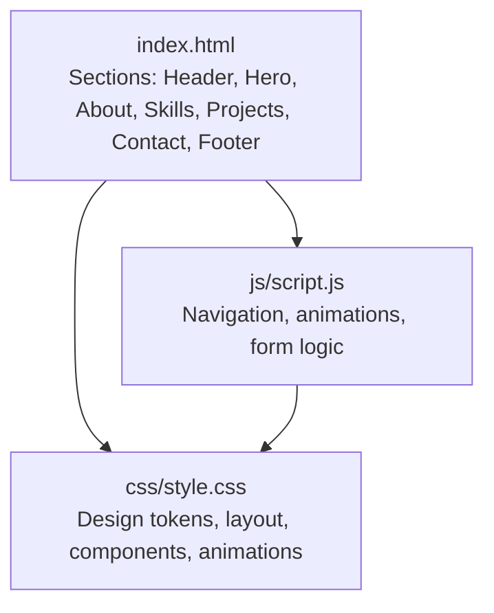
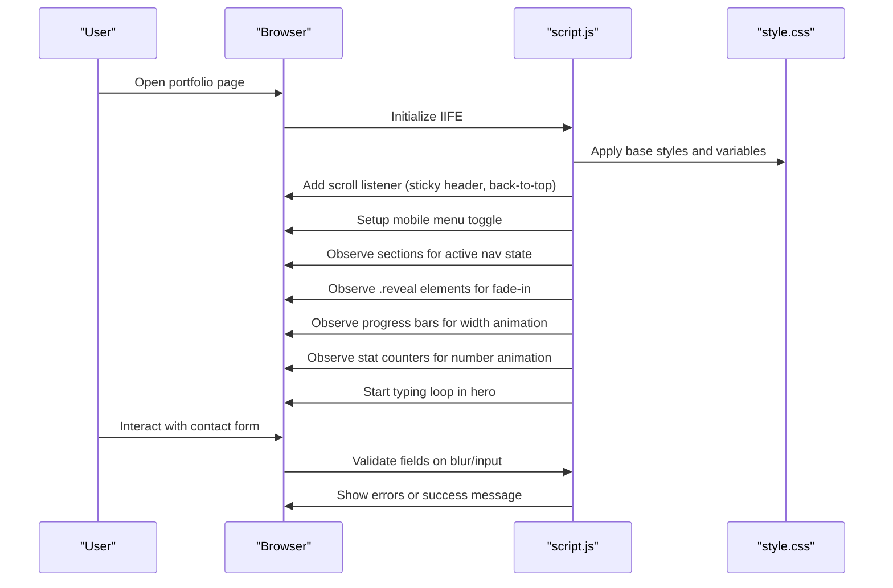
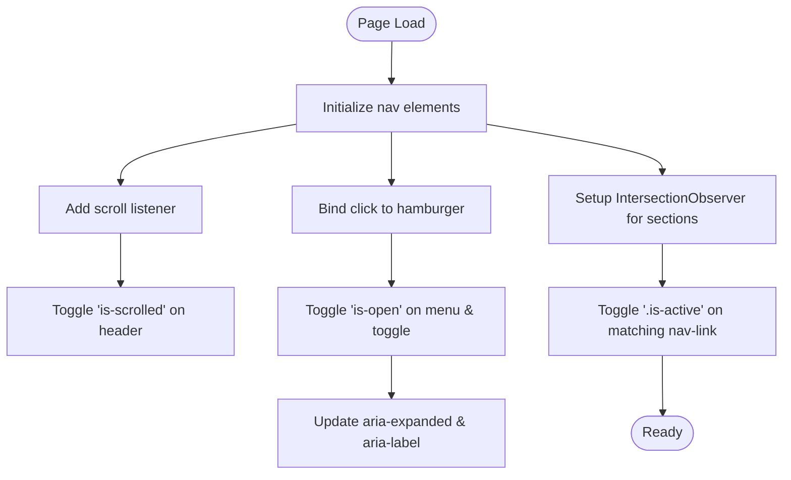
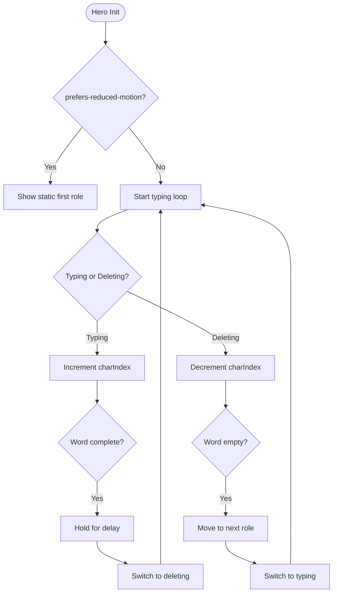
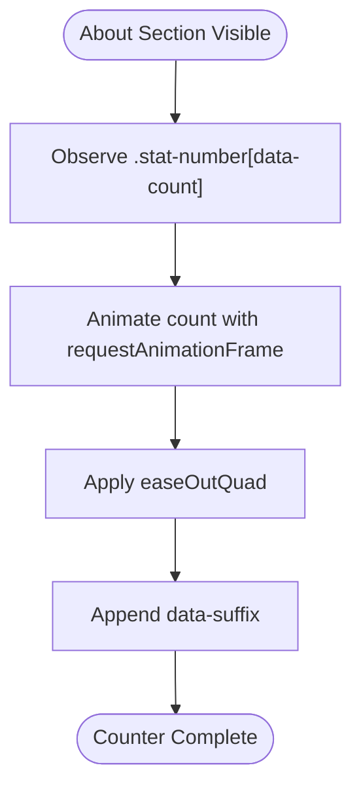
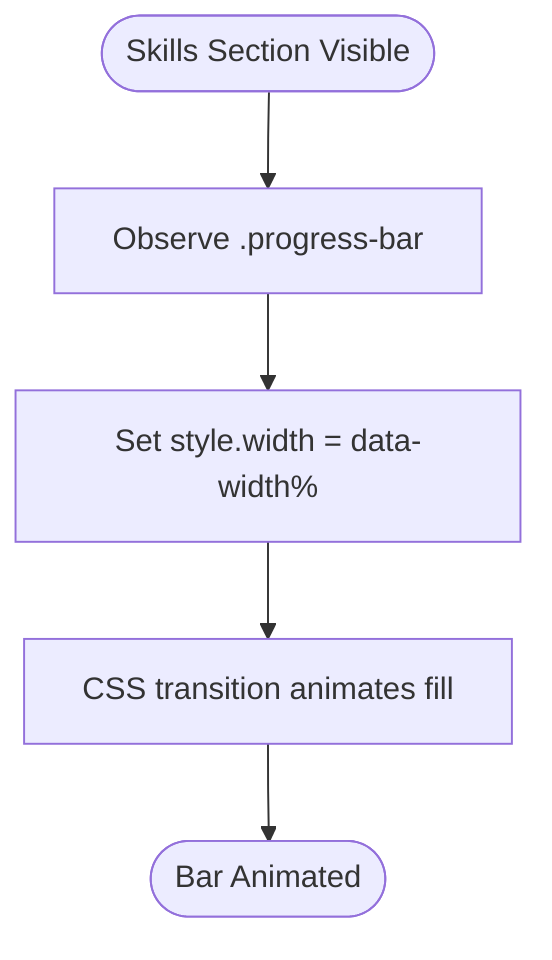
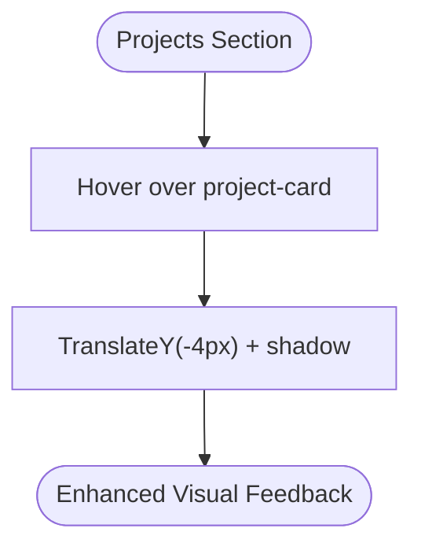
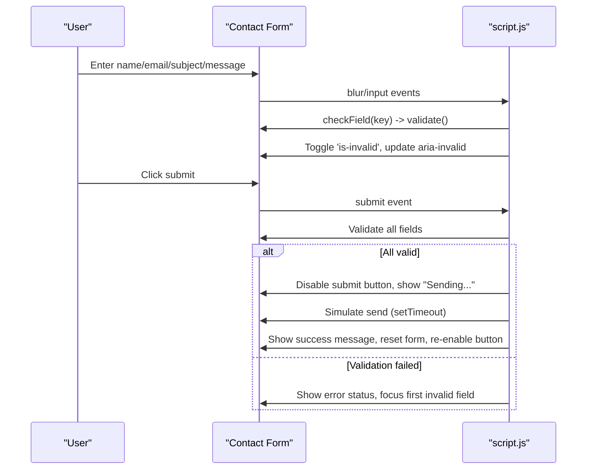
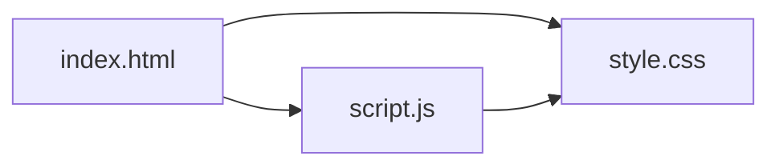

# Features Documentation

<cite>
**Referenced Files in This Document**
- [index.html](file://index.html)
- [style.css](file://css/style.css)
- [script.js](file://js/script.js)
</cite>

## Table of Contents
1. [Introduction](#introduction)
2. [Project Structure](#project-structure)
3. [Core Components](#core-components)
4. [Architecture Overview](#architecture-overview)
5. [Detailed Component Analysis](#detailed-component-analysis)
6. [Dependency Analysis](#dependency-analysis)
7. [Performance Considerations](#performance-considerations)
8. [Troubleshooting Guide](#troubleshooting-guide)
9. [Conclusion](#conclusion)

## Introduction
This portfolio website is a single-page, responsive site built with semantic HTML, modern CSS, and vanilla JavaScript. It includes:
- A sticky header with desktop navigation links and a mobile hamburger menu
- An animated hero section with typing animation, social media links, and call-to-action buttons
- An about section with personal information and animated statistics counters
- A skills showcase with progress bars and skill cards
- A projects gallery with hover effects and tags
- A contact form with real-time validation, error handling, and submission feedback
- Accessibility features such as keyboard focus styles, ARIA attributes, and reduced-motion support

The design uses CSS custom properties for consistent theming, smooth scroll behavior, and subtle motion effects that respect user preferences.

## Project Structure
The project follows a simple three-file structure:
- `index.html` defines the page sections and content
- `css/style.css` contains all styling, including layout, animations, and responsive rules
- `js/script.js` implements interactive behaviors like navigation, animations, and form validation

**Diagram sources**
- [index.html:21-539](file://index.html#L21-L539)
- [style.css:1-1508](file://css/style.css#L1-L1508)
- [script.js:1-388](file://js/script.js#L1-L388)

**Section sources**
- [index.html:1-539](file://index.html#L1-L539)
- [style.css:1-1508](file://css/style.css#L1-L1508)
- [script.js:1-388](file://js/script.js#L1-L388)

## Core Components
- Navigation system: Sticky header, desktop links, mobile hamburger menu, active state management via IntersectionObserver
- Hero section: Typing animation, gradient text, social icons, CTA buttons, decorative code window
- About section: Personal narrative, facts list, animated stat counters
- Skills showcase: Skill cards with percentage labels and animated progress bars
- Projects gallery: Cards with thumbnails, tags, and hover interactions
- Contact form: Real-time validation, accessible error messages, simulated submission feedback
- Back to top button and footer year updater

**Section sources**
- [index.html:21-539](file://index.html#L21-L539)
- [style.css:318-800](file://css/style.css#L318-L800)
- [script.js:21-388](file://js/script.js#L21-L388)

## Architecture Overview
The site is structured around clear sections in the HTML, styled by modular CSS classes, and enhanced by focused JavaScript modules. The main flow:
- On load, the script initializes scroll listeners, sets up the mobile menu, and observes sections for active states and reveal animations
- As users interact, the typing effect runs in the hero, progress bars animate when visible, and counters animate when scrolled into view
- The contact form validates inputs on blur and input events, then simulates submission with feedback

**Diagram sources**
- [script.js:21-388](file://js/script.js#L21-L388)
- [style.css:88-162](file://css/style.css#L88-L162)

## Detailed Component Analysis

### Navigation System
- Desktop navigation links: Home, About, Skills, Projects, Contact, plus a “Hire Me” CTA
- Mobile hamburger menu: Three-line toggle morphs into an X; menu slides open with body scroll lock while open
- Active state management: Uses IntersectionObserver to highlight the current section link based on viewport intersection
- Accessibility: ARIA attributes for menu toggle (`aria-expanded`, `aria-label`), keyboard Escape closes menu, focus-visible outlines

Implementation highlights:
- Toggle menu opens/closes and updates ARIA attributes
- Click outside menu or resizing to desktop closes it
- Scroll listener adds a glassy background class to the header
- IntersectionObserver toggles `.is-active` on nav links and sets `aria-current="page"`

Customization options:
- Change navigation items in HTML
- Adjust active threshold via observer settings
- Modify menu transition styles in CSS

**Diagram sources**
- [script.js:21-112](file://js/script.js#L21-L112)
- [style.css:318-445](file://css/style.css#L318-L445)

**Section sources**
- [index.html:21-51](file://index.html#L21-L51)
- [style.css:318-445](file://css/style.css#L318-L445)
- [script.js:21-112](file://js/script.js#L21-L112)

### Hero Section
- Typing animation: Cycles through roles with typing and deleting phases, respects reduced-motion preference
- Gradient text: Animated gradient applied to name using CSS background-clip
- Social media integration: Inline SVG icons for GitHub, LinkedIn, and Email with hover effects
- Call-to-action buttons: Primary and ghost buttons with hover lift and icon slide
- Decorative code window: Pure CSS mock terminal with floating animation

Implementation highlights:
- Typing loop manages character index, deletion/typing phases, and role cycling
- Cursor blinking via CSS animation
- Social links use inline SVGs and accessible labels
- Code window uses perspective transforms and hover transitions

Customization options:
- Edit roles array and timing constants in the typing loop
- Replace social URLs and labels
- Adjust gradient colors and animation durations in CSS

**Diagram sources**
- [script.js:191-241](file://js/script.js#L191-L241)
- [style.css:448-684](file://css/style.css#L448-L684)

**Section sources**
- [index.html:53-151](file://index.html#L53-L151)
- [style.css:448-684](file://css/style.css#L448-L684)
- [script.js:191-241](file://js/script.js#L191-L241)

### About Section
- Personal information: Narrative paragraphs and fact list with icons
- Animated statistics counters: Numbers count up when scrolled into view, with suffixes and easing
- Layout: Two-column grid with text and stat cards

Implementation highlights:
- Counters use requestAnimationFrame for smooth animation
- IntersectionObserver triggers counting once per element
- Stat cards have hover lift and gradient accents

Customization options:
- Edit stat numbers and labels in HTML
- Adjust animation duration and easing in the counter function
- Modify card styles and grid layout in CSS

**Diagram sources**
- [script.js:153-189](file://js/script.js#L153-L189)
- [style.css:686-788](file://css/style.css#L686-L788)

**Section sources**
- [index.html:153-226](file://index.html#L153-L226)
- [style.css:686-788](file://css/style.css#L686-L788)
- [script.js:153-189](file://js/script.js#L153-L189)

### Skills Showcase
- Skill cards: Each card includes an icon, title, percentage label, description, and progress bar
- Progress bars: Width set from `data-width` attribute when visible, animated via CSS transitions
- Grid layout: Responsive grid of skill cards

Implementation highlights:
- IntersectionObserver animates each progress bar only once when entering viewport
- ARIA attributes mark progress bars for accessibility

Customization options:
- Add/remove skill cards in HTML
- Update percentages and descriptions
- Adjust grid columns and spacing in CSS

**Diagram sources**
- [script.js:133-151](file://js/script.js#L133-L151)
- [style.css:790-800](file://css/style.css#L790-L800)

**Section sources**
- [index.html:228-327](file://index.html#L228-L327)
- [style.css:790-800](file://css/style.css#L790-L800)
- [script.js:133-151](file://js/script.js#L133-L151)

### Projects Gallery
- Project cards: Thumbnail area, title, description, tags, and links to live demo/source
- Hover effects: Cards lift and gain shadow; thumbnails include badges and glyphs
- Tags: Inline lists of technologies or themes

Implementation highlights:
- Cards use grid layout and hover transitions
- Thumbnails are styled placeholders with glyphs and badges
- Links include external arrow icons

Customization options:
- Add more project cards in HTML
- Replace placeholder thumbnails with images if desired
- Adjust hover styles and tag layouts in CSS

**Diagram sources**
- [style.css:800-1508](file://css/style.css#L800-L1508)

**Section sources**
- [index.html:329-420](file://index.html#L329-L420)
- [style.css:800-1508](file://css/style.css#L800-L1508)

### Contact Form
- Fields: Name, email, subject, message
- Real-time validation: Validates on blur and during input after initial invalid state
- Error handling: Displays field-level error messages, marks inputs invalid, and focuses first invalid field
- Submission feedback: Simulates sending with a loading state and success message; resets form afterward

Implementation highlights:
- Field configuration object maps inputs to validators and error containers
- Validators return empty string for valid or error message for invalid
- Submit handler prevents default, checks all fields, shows status, and simulates network delay
- Accessibility: `aria-invalid` toggled, `role="status"` with `aria-live="polite"` for status updates

Customization options:
- Extend validators and messages in the fields configuration
- Integrate a backend service by replacing the simulated send with fetch()
- Style error states and success messages in CSS

**Diagram sources**
- [script.js:243-346](file://js/script.js#L243-L346)
- [index.html:422-511](file://index.html#L422-L511)

**Section sources**
- [index.html:422-511](file://index.html#L422-L511)
- [script.js:243-346](file://js/script.js#L243-L346)

### Back to Top Button and Footer
- Back to top: Appears after scrolling down; smooth scrolls to top on click
- Footer year: Dynamically updates to current year

Implementation highlights:
- Scroll listener toggles visibility class for back-to-top
- Click handler uses smooth scroll behavior
- Year element updated on load

Customization options:
- Adjust scroll threshold for visibility
- Customize button appearance in CSS

**Section sources**
- [index.html:514-539](file://index.html#L514-L539)
- [script.js:348-359](file://js/script.js#L348-L359)

## Dependency Analysis
- HTML depends on CSS for visual presentation and on JS for interactivity
- CSS provides design tokens, component styles, and animations used across sections
- JS orchestrates behaviors: sticky header, mobile menu, active nav, reveal animations, progress bars, counters, typing effect, form validation, back-to-top, and dynamic year

**Diagram sources**
- [index.html:1-539](file://index.html#L1-L539)
- [style.css:1-1508](file://css/style.css#L1-L1508)
- [script.js:1-388](file://js/script.js#L1-L388)

**Section sources**
- [index.html:1-539](file://index.html#L1-L539)
- [style.css:1-1508](file://css/style.css#L1-L1508)
- [script.js:1-388](file://js/script.js#L1-L388)

## Performance Considerations
- Use passive scroll listeners to avoid blocking scrolling
- Prefer IntersectionObserver for scroll-triggered animations instead of heavy scroll handlers
- Limit expensive animations; respect `prefers-reduced-motion`
- Avoid layout thrashing by batching DOM reads/writes
- Keep CSS animations GPU-friendly where possible
- Minimize unnecessary reflows by toggling classes rather than inline styles

[No sources needed since this section provides general guidance]

## Troubleshooting Guide
- Hamburger menu not closing:
  - Ensure `.is-open` class is toggled correctly on both menu and toggle
  - Verify ARIA attributes update on toggle
  - Check resize listener closes menu on desktop widths
- Active nav link not updating:
  - Confirm sections have IDs matching nav hrefs
  - Verify IntersectionObserver thresholds and rootMargin
- Typing animation not working:
  - Check reduced-motion preference disables animation intentionally
  - Ensure typed element exists and roles array is defined
- Progress bars not animating:
  - Verify `.progress-bar` elements have `data-width` attributes
  - Ensure they become visible within viewport to trigger observer
- Counter animation not triggering:
  - Ensure stat numbers have `data-count` attributes
  - Check observer threshold and that elements are observed
- Form validation issues:
  - Confirm field IDs match validator keys
  - Check error containers exist and are updated
  - Validate email pattern matches expected format
- Back to top not appearing:
  - Verify scroll threshold and visibility class toggling
- Footer year not updating:
  - Ensure year element exists and script runs after DOM ready

**Section sources**
- [script.js:36-81](file://js/script.js#L36-L81)
- [script.js:83-112](file://js/script.js#L83-L112)
- [script.js:133-189](file://js/script.js#L133-L189)
- [script.js:191-241](file://js/script.js#L191-L241)
- [script.js:243-346](file://js/script.js#L243-L346)
- [script.js:348-359](file://js/script.js#L348-L359)

## Conclusion
This portfolio site delivers a polished, accessible, and performant user experience through well-structured HTML, modular CSS, and focused JavaScript. Key strengths include:
- Clear separation of concerns across files
- Smooth, respectful animations with accessibility considerations
- Robust navigation and interaction patterns
- Extensible form validation and feedback
- Easy customization points for content, styling, and behavior

By following the customization options and troubleshooting guidance, you can adapt the site to your own content and branding while maintaining high usability and performance.

[No sources needed since this section summarizes without analyzing specific files]