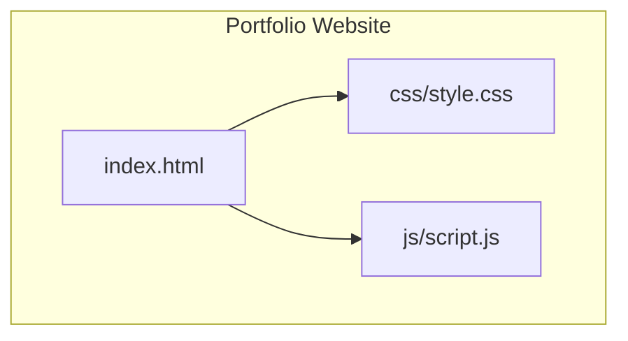
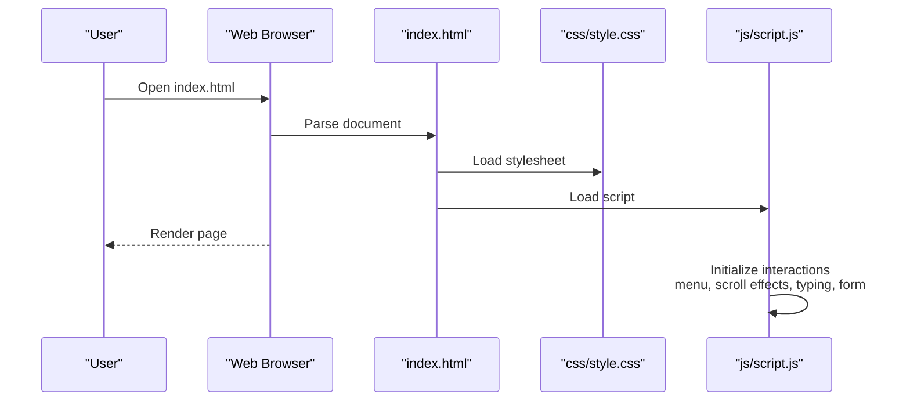

# Getting Started

<cite>
**Referenced Files in This Document**
- [index.html](file://index.html)
- [style.css](file://css/style.css)
- [script.js](file://js/script.js)
</cite>

## Table of Contents
1. [Introduction](#introduction)
2. [Project Structure](#project-structure)
3. [Quick Start](#quick-start)
4. [How the Site Works](#how-the-site-works)
5. [Customization Guide](#customization-guide)
6. [Adding New Sections](#adding-new-sections)
7. [Accessibility and Performance Notes](#accessibility-and-performance-notes)
8. [Troubleshooting](#troubleshooting)
9. [Conclusion](#conclusion)

## Introduction
This is a simple, static portfolio website with no build step, no package manager, and no external dependencies. You can run it locally by opening `index.html` directly in any modern web browser. The site uses:

- `index.html` for structure and content
- `css/style.css` for styling and theme variables
- `js/script.js` for interactivity such as the mobile menu, scroll animations, typing effect, and form validation

The design is dark-themed, responsive, and includes accessible markup, keyboard support, and reduced-motion considerations.

## Project Structure
The project has a minimal file layout:

**Diagram sources**
- [index.html:14-15](file://index.html#L14-L15)
- [index.html:537-537](file://index.html#L537-L537)

### What Each File Does
- `index.html`: Defines the page structure, sections, links, headings, images or SVG icons, and the contact form. It also loads the stylesheet and script.
- `css/style.css`: Contains CSS custom properties (design tokens), reset styles, component styles, section layouts, animations, and responsive rules.
- `js/script.js`: Implements vanilla JavaScript features including sticky header behavior, mobile navigation, active link tracking, reveal-on-scroll animations, skill bar animations, number counters, typing effect, form validation, back-to-top button, dynamic footer year, and a subtle mouse-follow glow.

**Section sources**
- [index.html:1-539](file://index.html#L1-L539)
- [style.css:1-18](file://css/style.css#L1-L18)
- [script.js:1-8](file://js/script.js#L1-L8)

## Quick Start
You do not need to install Node.js, Python, or any other tooling.

1. Make sure you have a modern web browser such as Chrome, Edge, Firefox, or Safari.
2. Open the folder containing this project.
3. Double-click `index.html`, or drag it into an open browser window.
4. The site should load immediately.

There is no server required. If you want to preview changes while editing files, simply refresh the browser tab.

**Section sources**
- [index.html:1-19](file://index.html#L1-L19)
- [index.html:536-538](file://index.html#L536-L538)

## How the Site Works
At a high level, the browser loads `index.html`. That file references the stylesheet and script, which then enhance the user experience.

**Diagram sources**
- [index.html:14-15](file://index.html#L14-L15)
- [index.html:537-537](file://index.html#L537-L537)
- [script.js:8-16](file://js/script.js#L8-L16)

### Key Interactive Features
- Sticky header that becomes glassy after scrolling
- Mobile hamburger menu with keyboard and accessibility support
- Active navigation highlighting based on visible sections
- Reveal-on-scroll animations for content blocks
- Animated skill progress bars
- Counting number animations
- Typing effect in the hero section
- Contact form validation and simulated submission feedback
- Back-to-top button
- Dynamic footer year
- Optional mouse-follow glow effect

**Section sources**
- [script.js:18-34](file://js/script.js#L18-L34)
- [script.js:36-81](file://js/script.js#L36-L81)
- [script.js:83-112](file://js/script.js#L83-L112)
- [script.js:114-131](file://js/script.js#L114-L131)
- [script.js:133-151](file://js/script.js#L133-L151)
- [script.js:153-189](file://js/script.js#L153-L189)
- [script.js:191-241](file://js/script.js#L191-L241)
- [script.js:243-346](file://js/script.js#L243-L346)
- [script.js:348-386](file://js/script.js#L348-L386)

## Customization Guide

### Change Personal Information
Most personal information lives in `index.html`. Look for:

- Page title and description in the document head
- Hero name, role text, and description
- About section biography and facts
- Skills list and descriptions
- Projects titles, descriptions, tags, and links
- Contact email, location, response time, and social links
- Footer credits and logo text

To update your details:
1. Open `index.html`.
2. Find the relevant section comment or heading.
3. Replace placeholder names, roles, links, and text with your own.
4. Save the file and refresh the browser.

For example:
- Update the page title near the top of `index.html`.
- Edit the hero name and subtitle inside the hero section.
- Edit the about paragraph and fact items.
- Edit each project card under the projects section.
- Edit contact email and location in the contact section.
- Edit the footer text and logo.

**Section sources**
- [index.html:6-7](file://index.html#L6-L7)
- [index.html:69-82](file://index.html#L69-L82)
- [index.html:166-203](file://index.html#L166-L203)
- [index.html:241-324](file://index.html#L241-L324)
- [index.html:342-418](file://index.html#L342-L418)
- [index.html:435-473](file://index.html#L435-L473)
- [index.html:517-528](file://index.html#L517-L528)

### Update Project Details
Each project is represented by a project card in the projects section. To add or edit projects:

1. Locate the projects grid in `index.html`.
2. Copy an existing project card block.
3. Change the title, description, tags, and links.
4. Adjust the thumbnail class if needed.
5. Remove or duplicate cards to match your portfolio size.

If you want real screenshots later, you can replace the current visual placeholders with image elements and adjust the CSS accordingly.

**Section sources**
- [index.html:332-419](file://index.html#L332-L419)

### Change Colors Using CSS Custom Properties
The theme is controlled through CSS custom properties at the top of `css/style.css`. These are called “design tokens.”

Key areas to customize:
- Background colors: base background, soft background, surface colors
- Text colors: main text, muted text, dim text
- Brand colors: primary color, accent color, success, danger, warning
- Gradients: main gradient, soft gradient, gradient text
- Typography: font families for body and headings
- Layout: container width and header height
- Motion: easing and speed values

To change the brand color:
1. Open `css/style.css`.
2. Find the `:root` block near the top.
3. Change `--primary` and related variables such as `--primary-light`.
4. Optionally update gradients like `--gradient` and `--gradient-text`.
5. Refresh the browser.

Because most colors use these variables, changing them updates buttons, accents, highlights, and decorative elements consistently.

**Section sources**
- [style.css:20-73](file://css/style.css#L20-L73)
- [style.css:193-267](file://css/style.css#L193-L267)

### Change Fonts
Fonts are loaded from Google Fonts in `index.html`, and font families are defined in `css/style.css`.

To change fonts:
1. In `index.html`, update the Google Fonts link to include the new font family.
2. In `css/style.css`, update `--font-body` and `--font-heading` in the `:root` block.
3. Refresh the browser.

Keep fallback system fonts in place so the page still looks reasonable if the web font fails to load.

**Section sources**
- [index.html:9-12](file://index.html#L9-L12)
- [style.css:62-65](file://css/style.css#L62-L65)

### Change Spacing and Layout
Layout-related variables live in the `:root` block of `css/style.css`:
- `--container` controls maximum content width
- `--header-height` controls sticky header height
- Section padding and spacing are defined in section-specific classes

Adjust these values carefully and test on both desktop and mobile viewports.

**Section sources**
- [style.css:66-69](file://css/style.css#L66-L69)
- [style.css:174-180](file://css/style.css#L174-L180)
- [style.css:275-286](file://css/style.css#L275-L286)

### Customize Interactions
Interactions are implemented in `js/script.js`. Common customization points include:

- Mobile menu behavior: toggle logic, closing on link click, Escape key handling, and resize cleanup
- Active nav link tracking using IntersectionObserver
- Reveal-on-scroll animation thresholds
- Skill bar animation trigger threshold
- Number counter duration and easing
- Typing effect roles, speeds, and hold time
- Contact form validation rules and messages
- Back-to-top scroll behavior
- Mouse-follow glow activation conditions

For beginners, start by editing text strings such as validation messages or typing roles. For experienced developers, extend the script by adding new observers or event listeners.

**Section sources**
- [script.js:36-81](file://js/script.js#L36-L81)
- [script.js:83-112](file://js/script.js#L83-L112)
- [script.js:114-131](file://js/script.js#L114-L131)
- [script.js:133-151](file://js/script.js#L133-L151)
- [script.js:153-189](file://js/script.js#L153-L189)
- [script.js:191-241](file://js/script.js#L191-L241)
- [script.js:243-346](file://js/script.js#L243-L346)
- [script.js:348-386](file://js/script.js#L348-L386)

## Adding New Sections
To add a new section:

1. Add a new `<section>` element in `index.html` below the existing sections.
2. Give it a unique `id` attribute so navigation can link to it.
3. Add a matching navigation link in the header menu.
4. Style the section using existing classes such as `.section`, `.section-alt`, `.container`, and `.section-head`.
5. If you want reveal-on-scroll animation, add the `reveal` class to elements that should fade in.
6. If you want interactive behavior, add corresponding JavaScript in `js/script.js`.

Example pattern:
- Create a section with an id like `new-section`.
- Add a nav link with `href="#new-section"`.
- Use semantic HTML inside the section.
- Apply consistent typography and spacing from the existing design system.

**Section sources**
- [index.html:26-51](file://index.html#L26-L51)
- [index.html:156-226](file://index.html#L156-L226)
- [index.html:231-327](file://index.html#L231-L327)
- [index.html:332-419](file://index.html#L332-L419)
- [index.html:425-511](file://index.html#L425-L511)
- [style.css:275-316](file://css/style.css#L275-L316)
- [script.js:114-131](file://js/script.js#L114-L131)

## Accessibility and Performance Notes
- The site uses semantic HTML elements such as `header`, `main`, `section`, `nav`, and `footer`.
- Navigation links include `aria-label` attributes where appropriate.
- The mobile menu toggles `aria-expanded` and manages focus behavior.
- Focus outlines are preserved for keyboard users.
- Reduced-motion preferences are respected for animations and the typing effect.
- Scroll events use passive listeners for smoother scrolling.
- Animations use `IntersectionObserver` instead of heavy scroll calculations.
- No external libraries are loaded; only Google Fonts are fetched.

These choices make the site lightweight and more usable for assistive technologies and slower connections.

**Section sources**
- [index.html:26-51](file://index.html#L26-L51)
- [index.html:94-117](file://index.html#L94-L117)
- [index.html:475-508](file://index.html#L475-L508)
- [style.css:157-168](file://css/style.css#L157-L168)
- [script.js:32-33](file://js/script.js#L32-L33)
- [script.js:237-241](file://js/script.js#L237-L241)
- [script.js:365-386](file://js/script.js#L365-L386)

## Troubleshooting

### The Page Looks Broken After Opening Locally
- Make sure you opened `index.html` directly, not a copied version without the `css` and `js` folders.
- Check that the relative paths `css/style.css` and `js/script.js` still exist.
- Clear the browser cache if styles did not update after editing.

**Section sources**
- [index.html:14-15](file://index.html#L14-L15)
- [index.html:537-537](file://index.html#L537-L537)

### Changes Are Not Showing Up
- Save all edited files before refreshing.
- Hard-refresh the browser if necessary.
- Verify that your edits are in the correct file: content in `index.html`, styles in `css/style.css`, and behavior in `js/script.js`.

**Section sources**
- [index.html:1-539](file://index.html#L1-L539)
- [style.css:1-18](file://css/style.css#L1-L18)
- [script.js:1-8](file://js/script.js#L1-L8)

### Mobile Menu Is Not Working
- Ensure the script is loaded at the bottom of the page.
- Check that the toggle button and menu IDs match those referenced in `script.js`.
- Confirm that no console errors are blocking execution.

**Section sources**
- [index.html:32-49](file://index.html#L32-L49)
- [index.html:537-537](file://index.html#L537-L537)
- [script.js:36-81](file://js/script.js#L36-L81)

### Form Validation Shows Unexpected Errors
- Check the validation rules in `script.js`.
- Ensure field IDs and error message elements match the expected selectors.
- Test with short inputs, invalid emails, and empty fields.

**Section sources**
- [index.html:475-508](file://index.html#L475-L508)
- [script.js:243-346](file://js/script.js#L243-L346)

### Animations Feel Slow or Janky
- Reduce the number of heavy animations.
- Respect `prefers-reduced-motion`.
- Avoid animating large layout-changing properties.
- Keep animations short and use GPU-friendly properties when possible.

**Section sources**
- [script.js:114-131](file://js/script.js#L114-L131)
- [script.js:133-151](file://js/script.js#L133-L151)
- [script.js:153-189](file://js/script.js#L153-L189)
- [script.js:237-241](file://js/script.js#L237-L241)

## Conclusion
This portfolio site is designed to be easy to run, easy to read, and easy to customize. Start by opening `index.html` in your browser, then personalize the content in `index.html`, adjust the theme in `css/style.css`, and extend behavior in `js/script.js`. Because there are no build tools or dependencies, you can iterate quickly and share your work by hosting the same three-file structure anywhere static files are supported.