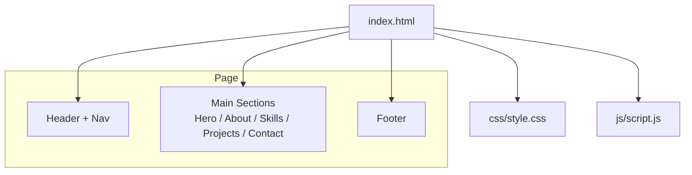
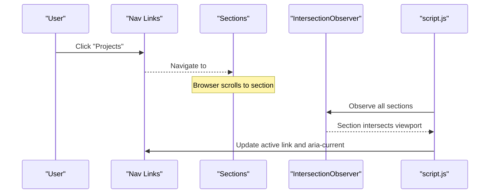
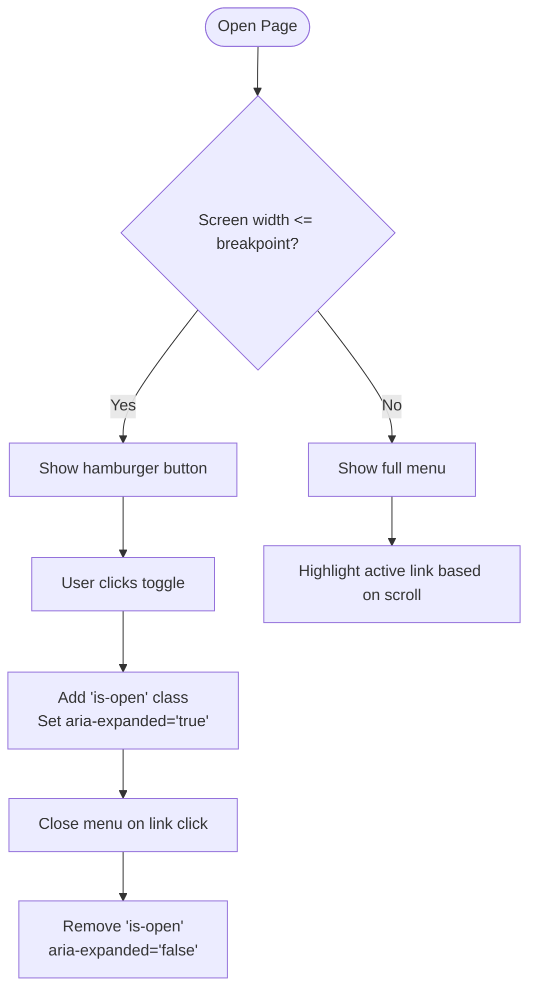
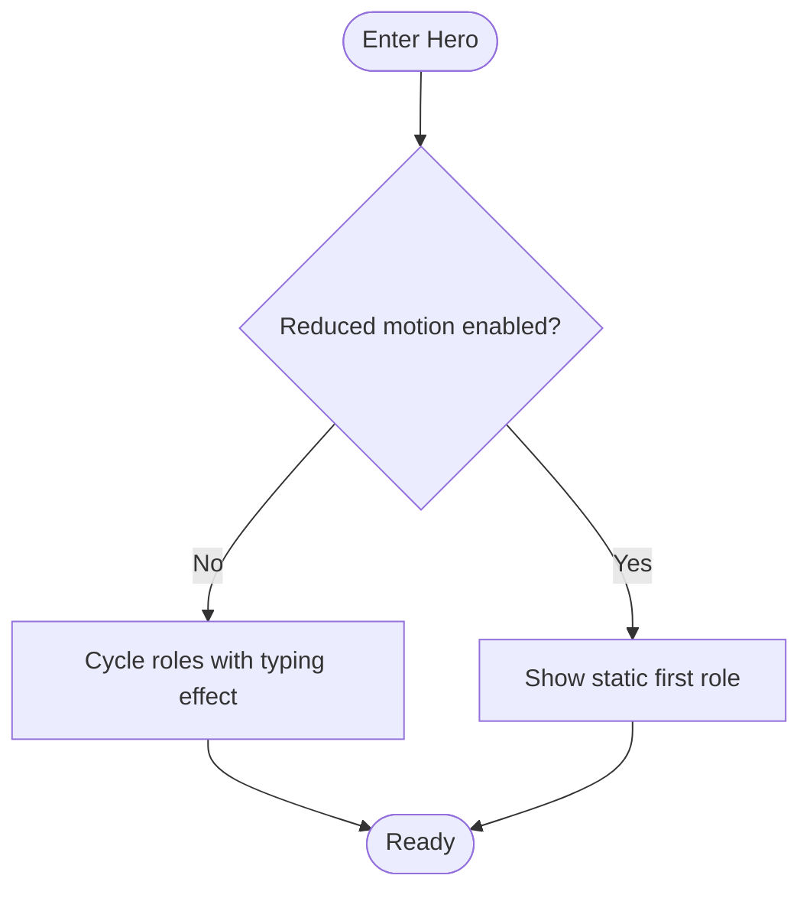
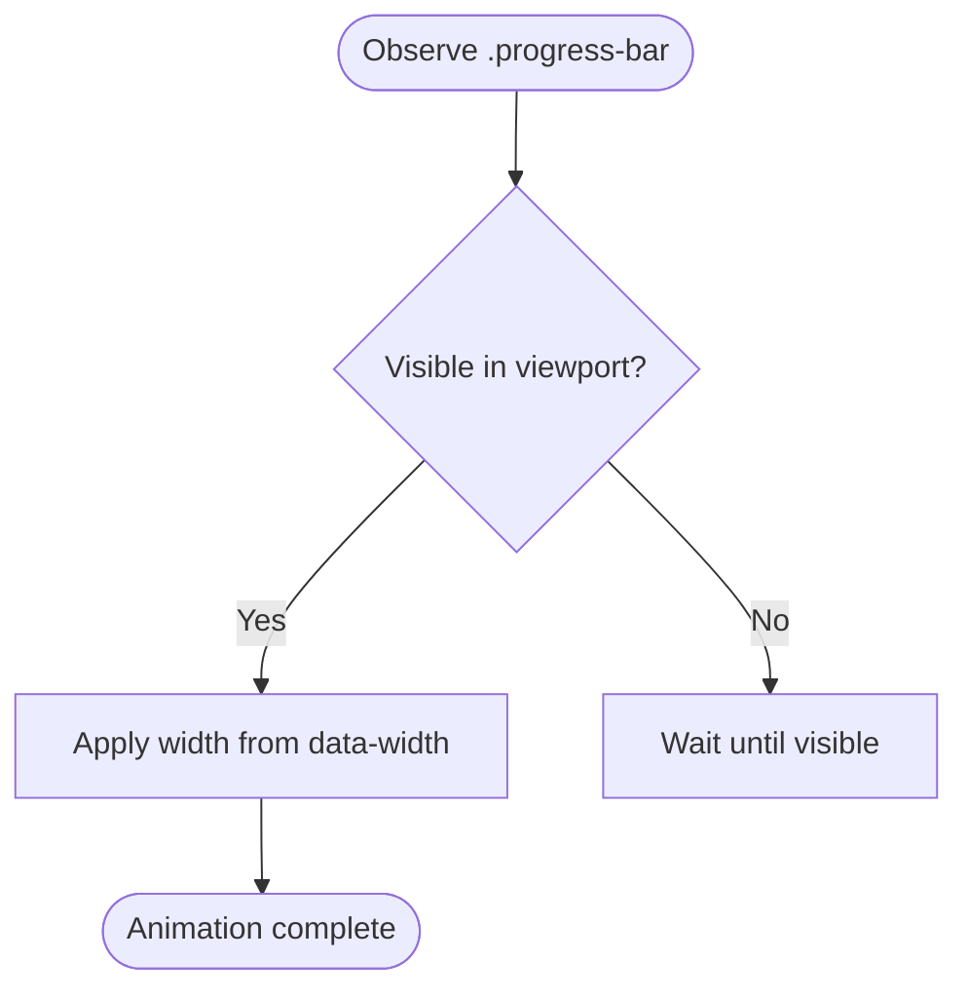
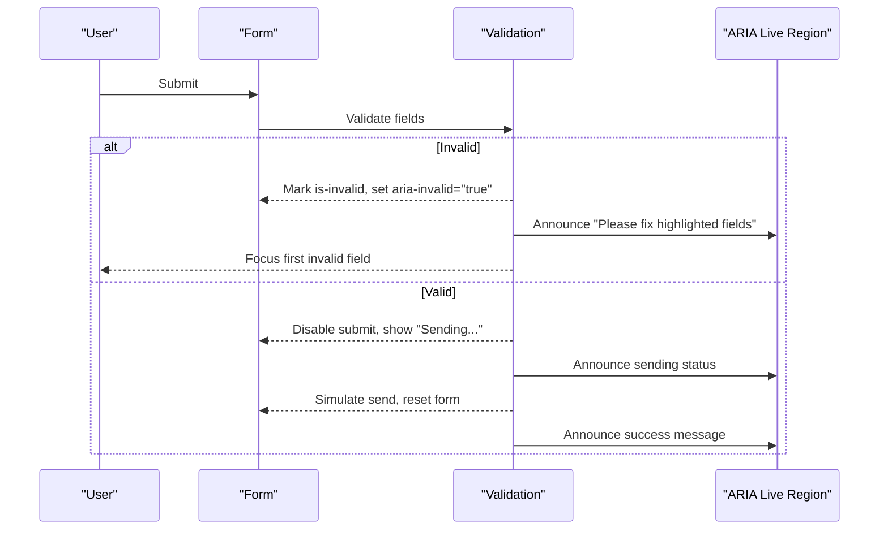
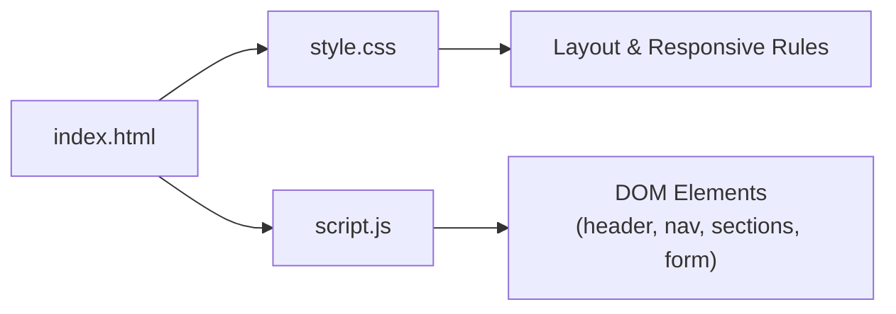

# HTML Structure

<cite>
**Referenced Files in This Document**
- [index.html](file://index.html)
- [style.css](file://css/style.css)
- [script.js](file://js/script.js)
</cite>

## Table of Contents
1. [Introduction](#introduction)
2. [Project Structure](#project-structure)
3. [Core Components](#core-components)
4. [Architecture Overview](#architecture-overview)
5. [Detailed Component Analysis](#detailed-component-analysis)
6. [Dependency Analysis](#dependency-analysis)
7. [Performance Considerations](#performance-considerations)
8. [Troubleshooting Guide](#troubleshooting-guide)
9. [Conclusion](#conclusion)

## Introduction
This document explains the HTML structure of a single-page portfolio website. It focuses on semantic markup organization, accessibility features, SEO considerations, anchor-based navigation, and how the structure supports responsive design. The site is organized into a header with navigation, main content sections (hero, about, skills, projects, contact), and a footer. JavaScript provides interactivity such as mobile menu toggling, scroll-aware active states, reveal animations, skill bar animations, typing effects, form validation, and a back-to-top button.

## Project Structure
The project uses a simple, flat structure:
- index.html: page markup, meta tags, links to styles and scripts
- css/style.css: design tokens, reset, layout, section styles, responsive rules
- js/script.js: vanilla JavaScript for interactivity and accessibility behaviors

**Diagram sources**
- [index.html:1-539](file://index.html#L1-L539)
- [style.css:1-1508](file://css/style.css#L1-L1508)
- [script.js:1-388](file://js/script.js#L1-L388)

**Section sources**
- [index.html:1-539](file://index.html#L1-L539)

## Core Components
- Header and navigation: sticky top bar with logo, anchor links, and a mobile hamburger toggle.
- Main content sections: hero, about, skills, projects, contact. Each section has an id used for anchor navigation.
- Footer: branding, copyright year, and quick links.
- Back-to-top button: appears after scrolling and scrolls to the top smoothly.

Key structural patterns:
- Semantic elements: html, head, body, header, nav, main, section, article, footer, form, label, input, textarea, button, ul/li.
- Section IDs: home, about, skills, projects, contact.
- ARIA attributes: aria-label, aria-expanded, aria-controls, aria-hidden, aria-current, aria-invalid, aria-live, role="progressbar", role="status".
- Keyboard support: focus-visible outlines, Escape key closes mobile menu, logical tab order, accessible labels.

**Section sources**
- [index.html:21-539](file://index.html#L21-L539)

## Architecture Overview
The site follows a single-page application pattern using anchor-based navigation. Clicking a navigation link jumps to the corresponding section via its id. JavaScript enhances this by:
- Highlighting the active section while scrolling
- Managing the mobile menu state and keyboard behavior
- Animating skill bars and counters when they enter the viewport
- Providing a typing effect in the hero
- Validating the contact form and announcing status updates

**Diagram sources**
- [index.html:27-50](file://index.html#L27-L50)
- [index.html:57-511](file://index.html#L57-L511)
- [script.js:88-112](file://js/script.js#L88-L112)

## Detailed Component Analysis

### Header and Navigation
- Uses <header> and <nav> with aria-label for screen readers.
- Hamburger button controls the mobile menu with aria-expanded and aria-controls.
- Anchor links point to section ids for smooth scrolling.
- CSS adds a glassy background when scrolled and highlights the active link.

Accessibility highlights:
- aria-label="Main navigation"
- aria-expanded toggled by JavaScript
- aria-controls="navMenu"
- :focus-visible outline for keyboard users

Responsive behavior:
- On small screens, the menu collapses behind a toggle.
- Body overflow is locked while the menu is open to prevent background scrolling.

**Diagram sources**
- [index.html:26-51](file://index.html#L26-L51)
- [style.css:321-445](file://css/style.css#L321-L445)
- [script.js:39-81](file://js/script.js#L39-L81)

**Section sources**
- [index.html:26-51](file://index.html#L26-L51)
- [style.css:321-445](file://css/style.css#L321-L445)
- [script.js:39-81](file://js/script.js#L39-L81)

### Hero Section
- Semantic heading hierarchy: h1 for the main title, h2 for the subtitle.
- Decorative SVGs use aria-hidden="true" to avoid noise for assistive technologies.
- Social links include descriptive aria-labels.
- A scroll hint link points to the next section with an accessible label.

SEO considerations:
- Title tag and description meta tag are present.
- Meaningful headings improve readability and indexing.

**Diagram sources**
- [index.html:57-151](file://index.html#L57-L151)
- [script.js:195-241](file://js/script.js#L195-L241)

**Section sources**
- [index.html:57-151](file://index.html#L57-L151)
- [script.js:195-241](file://js/script.js#L195-L241)

### About Section
- Uses <section> with id="about".
- Contains paragraphs, lists, and stat cards.
- Stat numbers animate when visible.

Accessibility highlights:
- Icons use aria-hidden="true".
- No interactive elements require special handling here.

**Section sources**
- [index.html:156-226](file://index.html#L156-L226)
- [script.js:159-189](file://js/script.js#L159-L189)

### Skills Section
- Each skill is an <article> with a progress bar.
- Progress containers use role="progressbar" with aria-label, aria-valuenow, aria-valuemin, aria-valuemax.
- Widths are set from data-width attributes when the bars become visible.

Accessibility highlights:
- Screen readers announce skill levels via aria-label and values.
- Visual-only icons use aria-hidden="true".

**Diagram sources**
- [index.html:231-327](file://index.html#L231-L327)
- [script.js:139-151](file://js/script.js#L139-L151)

**Section sources**
- [index.html:231-327](file://index.html#L231-L327)
- [script.js:139-151](file://js/script.js#L139-L151)

### Projects Section
- Each project is an <article> with a thumbnail area, description, tags list, and links.
- Decorative thumbnails use aria-hidden="true".
- Links to live demos and source code are semantically clear.

**Section sources**
- [index.html:332-420](file://index.html#L332-L420)

### Contact Section
- Uses <form> with labeled inputs and error messages.
- Validation is handled in JavaScript; errors update aria-invalid and show inline messages.
- Status message uses role="status" and aria-live="polite" for announcements.

Accessibility highlights:
- Labels explicitly associated with inputs via for/id.
- Error messages are linked to fields and announced to screen readers.
- Focus moves to the first invalid field on failed submission.

**Diagram sources**
- [index.html:475-508](file://index.html#L475-L508)
- [script.js:249-346](file://js/script.js#L249-L346)

**Section sources**
- [index.html:425-511](file://index.html#L425-L511)
- [script.js:249-346](file://js/script.js#L249-L346)

### Footer
- Contains branding, dynamic year, and quick links.
- Simple and semantic with no complex interactions.

**Section sources**
- [index.html:517-529](file://index.html#L517-L529)
- [script.js:358-359](file://js/script.js#L358-L359)

## Dependency Analysis
- index.html depends on style.css for visual presentation and script.js for interactivity.
- script.js manipulates DOM classes and attributes to reflect state (e.g., is-open, is-active, is-visible).
- CSS variables define design tokens used across components.

**Diagram sources**
- [index.html:1-539](file://index.html#L1-L539)
- [style.css:1-1508](file://css/style.css#L1-L1508)
- [script.js:1-388](file://js/script.js#L1-L388)

**Section sources**
- [index.html:1-539](file://index.html#L1-L539)
- [style.css:1-1508](file://css/style.css#L1-L1508)
- [script.js:1-388](file://js/script.js#L1-L388)

## Performance Considerations
- Passive scroll listeners improve scrolling performance.
- IntersectionObserver is used instead of heavy scroll calculations for revealing elements, highlighting active sections, and animating skill bars.
- requestAnimationFrame is used for smooth number counting animation.
- Reduced-motion media queries disable animations for users who prefer less motion.

[No sources needed since this section provides general guidance]

## Troubleshooting Guide
Common issues and fixes:
- Mobile menu not closing:
  - Ensure the toggle button has correct aria-expanded and aria-controls attributes.
  - Verify that clicking outside the menu or pressing Escape triggers close logic.
- Active link not updating:
  - Confirm each section has a unique id matching the nav href.
  - Check that IntersectionObserver is observing all sections with ids.
- Form validation errors not announced:
  - Ensure the status element has role="status" and aria-live="polite".
  - Verify aria-invalid is updated on invalid fields.
- Animations causing discomfort:
  - Respect prefers-reduced-motion; typing effect and mouse-follow glow are disabled when reduced motion is preferred.

**Section sources**
- [script.js:39-81](file://js/script.js#L39-L81)
- [script.js:88-112](file://js/script.js#L88-L112)
- [script.js:249-346](file://js/script.js#L249-L346)
- [script.js:237-241](file://js/script.js#L237-L241)

## Conclusion
The portfolio’s HTML structure emphasizes semantic markup, accessibility, and SEO best practices. Sections are clearly delineated with meaningful ids, enabling anchor-based navigation. ARIA attributes and keyboard-friendly interactions ensure compatibility with assistive technologies. The responsive design relies on CSS variables, modern layout techniques, and media queries, while JavaScript enhances usability without compromising accessibility. This combination results in a performant, maintainable, and inclusive single-page experience.