# JavaScript Functionality

<cite>
**Referenced Files in This Document**
- [script.js](file://js/script.js)
- [index.html](file://index.html)
</cite>

## Table of Contents
1. [Introduction](#introduction)
2. [Project Structure](#project-structure)
3. [Core Components](#core-components)
4. [Architecture Overview](#architecture-overview)
5. [Detailed Component Analysis](#detailed-component-analysis)
6. [Dependency Analysis](#dependency-analysis)
7. [Performance Considerations](#performance-considerations)
8. [Troubleshooting Guide](#troubleshooting-guide)
9. [Conclusion](#conclusion)
10. [Appendices](#appendices)

## Introduction
This document explains the JavaScript functionality powering the portfolio website. The code is written in plain, modern JavaScript with no external libraries. It uses an Immediately Invoked Function Expression (IIFE) to encapsulate behavior and avoid global namespace pollution. The script implements several user-facing features:

- Mobile hamburger menu toggle with accessibility attributes
- Sticky header that changes appearance after scrolling
- Active navigation highlighting based on scroll position
- Scroll-triggered reveal animations for sections and cards
- Animated skill bars that fill when visible
- Animated statistics counters that count up when scrolled into view
- Typing animation effect in the hero section
- Back-to-top button with smooth scrolling
- Contact form validation with accessible error feedback
- A subtle desktop-only mouse-follow glow effect

The implementation emphasizes performance by using IntersectionObserver for scroll detection, passive event listeners where appropriate, requestAnimationFrame for smooth animations, and DOM class toggling instead of heavy layout calculations.

## Project Structure
The project has a minimal structure:

- `index.html`: Contains the page markup, semantic sections, data attributes for JS-driven behaviors, and links to styles and scripts.
- `css/style.css`: Styles for layout, transitions, and visual states used by the JavaScript (for example, `.is-open`, `.is-visible`, `.is-scrolled`).
- `js/script.js`: All interactive logic wrapped in an IIFE.

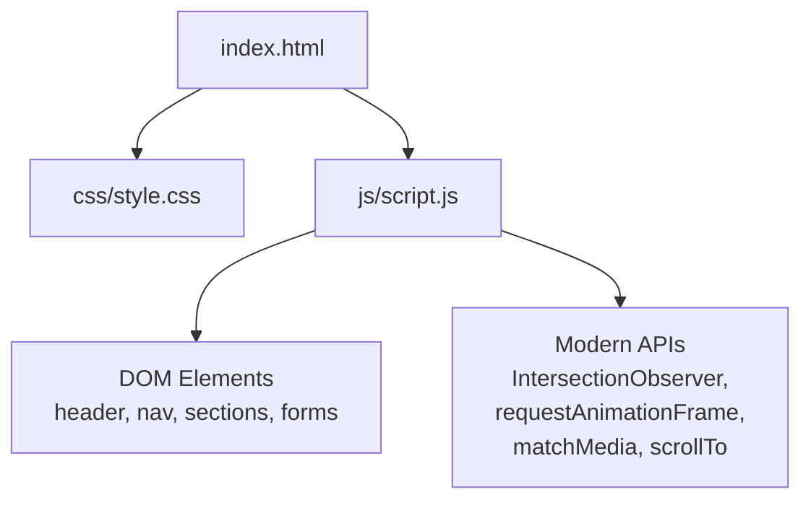

**Diagram sources**
- [index.html:1-540](file://index.html#L1-L540)
- [script.js:1-388](file://js/script.js#L1-L388)

**Section sources**
- [index.html:1-540](file://index.html#L1-L540)
- [script.js:1-388](file://js/script.js#L1-L388)

## Core Components
The script organizes its behavior into clear modules inside one file. Each module targets specific elements and responsibilities:

- **Sticky Header and Back-to-Top**: Adds a glassy background class to the header when scrolled and shows or hides the back-to-top button.
- **Mobile Menu**: Toggles the mobile navigation, locks body scroll while open, updates ARIA attributes, and closes on link click, Escape key, outside click, or resize to desktop width.
- **Active Navigation Highlighting**: Uses IntersectionObserver to mark the current section’s nav link as active.
- **Reveal Animations**: Observes elements with a reveal class and adds a visibility class once they enter the viewport.
- **Skill Bars**: Reads percentage values from data attributes and animates bar widths when visible.
- **Animated Counters**: Counts numbers up with easing when their container becomes visible.
- **Typing Effect**: Cycles through roles, typing and deleting text with timing controls and reduced-motion support.
- **Contact Form Validation**: Validates fields on blur and input, prevents default submission, simulates sending, and provides accessible status messages.
- **Mouse Glow**: Creates a decorative radial gradient element that follows the cursor on hover-capable devices.

**Section sources**
- [script.js:18-388](file://js/script.js#L18-L388)

## Architecture Overview
At a high level, the script initializes helpers, selects DOM nodes, sets up observers and event listeners, and reacts to user interactions and scroll events. The architecture separates concerns cleanly:

- Initialization and selection
- Scroll-based UI state
- Menu interaction
- Section observation
- Animation orchestration
- Form handling
- Accessibility management

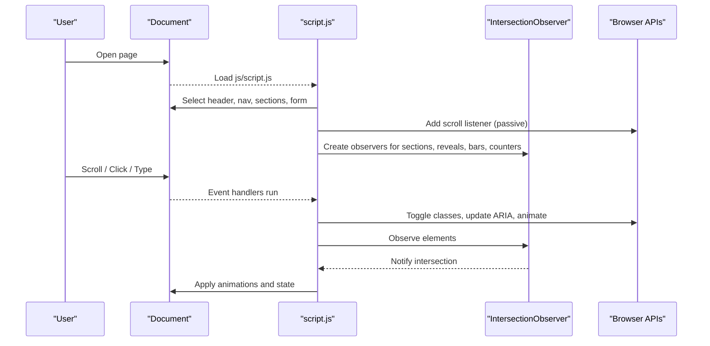

**Diagram sources**
- [script.js:21-388](file://js/script.js#L21-L388)
- [index.html:26-537](file://index.html#L26-L537)

## Detailed Component Analysis

### Modular IIFE Pattern and Separation of Concerns
The entire script is wrapped in an IIFE to keep variables private and avoid polluting the global scope. Inside the function:

- Helpers `$` and `$$` wrap `querySelector` and `querySelectorAll`.
- Each feature is defined as a named function or block with clear comments.
- DOM references are cached at the top of each feature block.
- Event listeners are attached only when needed.
- Modern APIs like `IntersectionObserver`, `matchMedia`, and `requestAnimationFrame` are used purposefully.

This pattern makes it easy to extend the script by adding new blocks without affecting existing behavior.

**Section sources**
- [script.js:1-16](file://js/script.js#L1-L16)
- [script.js:18-388](file://js/script.js#L18-L388)

### Mobile Hamburger Menu Toggle
Responsibilities:
- Toggle the open state of the navigation menu.
- Update ARIA attributes for accessibility (`aria-expanded`, `aria-label`).
- Lock body scroll while the menu is open.
- Close the menu when a link is clicked, Escape is pressed, clicking outside, or resizing to desktop width.

Key behaviors:
- `toggleMenu` toggles classes and ARIA attributes.
- `closeMenu` resets state and unlocks body scroll.
- Listeners handle clicks, keyboard, outside clicks, and resize.

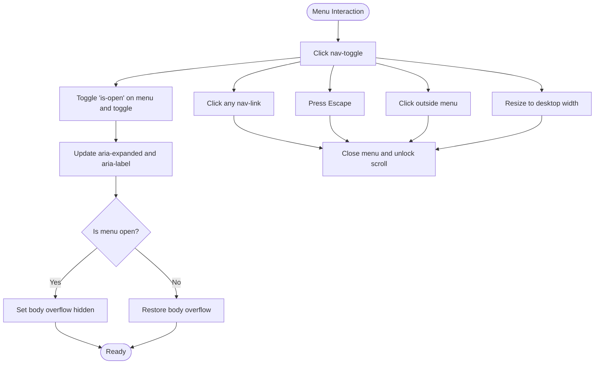

**Diagram sources**
- [script.js:39-81](file://js/script.js#L39-L81)
- [index.html:26-50](file://index.html#L26-L50)

**Section sources**
- [script.js:39-81](file://js/script.js#L39-L81)
- [index.html:26-50](file://index.html#L26-L50)

### Sticky Header Behavior
Responsibilities:
- Add a styled class to the header when the user scrolls past a small threshold.
- Show or hide the back-to-top button based on scroll depth.

Implementation highlights:
- Uses a passive scroll listener for performance.
- Toggles classes rather than recalculating styles directly.
- Runs once on load to handle pages already scrolled.

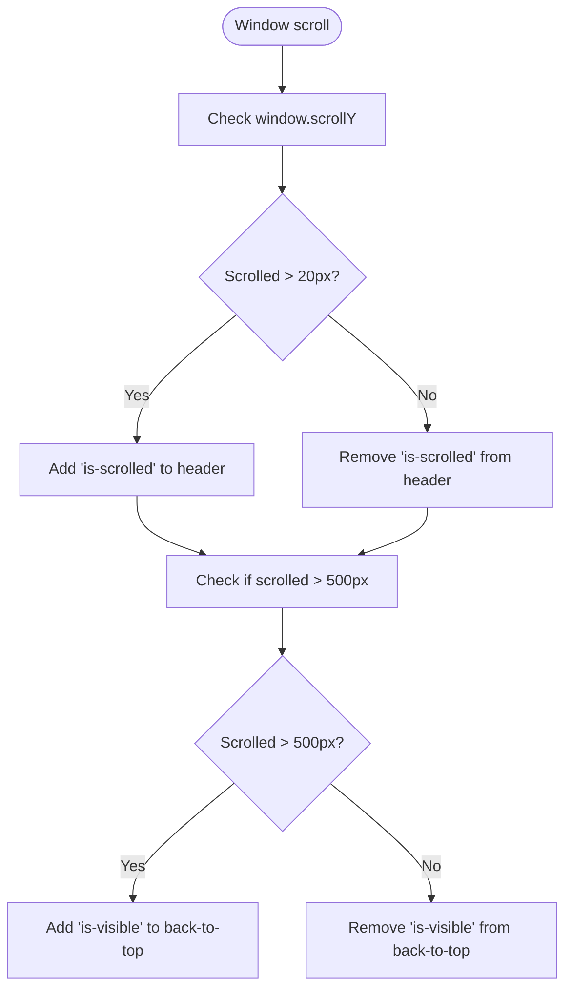

**Diagram sources**
- [script.js:21-34](file://js/script.js#L21-L34)
- [index.html:26-26](file://index.html#L26-L26)
- [index.html:532-534](file://index.html#L532-L534)

**Section sources**
- [script.js:21-34](file://js/script.js#L21-L34)
- [index.html:26-26](file://index.html#L26-L26)
- [index.html:532-534](file://index.html#L532-L534)

### Active Navigation While Scrolling
Responsibilities:
- Highlight the nav link corresponding to the currently visible section.
- Update ARIA attributes for screen readers.

Implementation highlights:
- Uses `IntersectionObserver` with a custom `rootMargin` so the middle band of the viewport triggers the change.
- Iterates over all nav links and toggles the active class and `aria-current`.

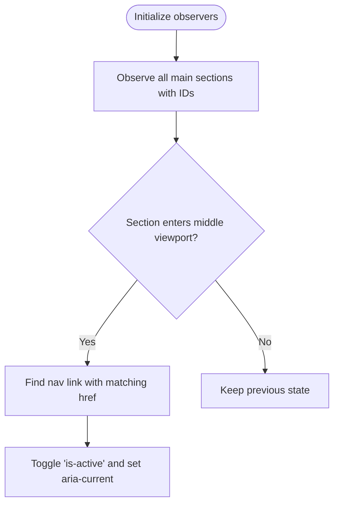

**Diagram sources**
- [script.js:88-112](file://js/script.js#L88-L112)
- [index.html:40-49](file://index.html#L40-L49)

**Section sources**
- [script.js:88-112](file://js/script.js#L88-L112)
- [index.html:40-49](file://index.html#L40-L49)

### Scroll-Triggered Reveal Animations
Responsibilities:
- Fade in elements marked with a reveal class when they become visible.
- Unobserve elements after revealing so animations play only once.

Implementation highlights:
- Uses `IntersectionObserver` with a threshold and margin to trigger early enough for smooth visuals.
- Applies a visibility class that CSS transitions can animate.

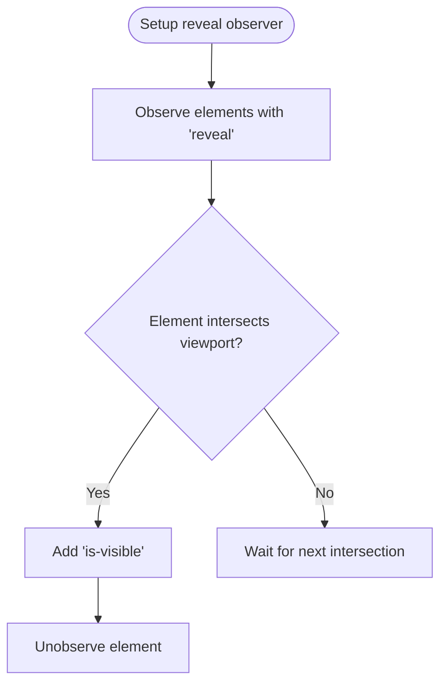

**Diagram sources**
- [script.js:119-131](file://js/script.js#L119-L131)
- [index.html:158-164](file://index.html#L158-L164)
- [index.html:166-223](file://index.html#L166-L223)
- [index.html:233-324](file://index.html#L233-L324)
- [index.html:334-417](file://index.html#L334-L417)
- [index.html:427-429](file://index.html#L427-L429)

**Section sources**
- [script.js:119-131](file://js/script.js#L119-L131)
- [index.html:158-164](file://index.html#L158-L164)
- [index.html:166-223](file://index.html#L166-L223)
- [index.html:233-324](file://index.html#L233-L324)
- [index.html:334-417](file://index.html#L334-L417)
- [index.html:427-429](file://index.html#L427-L429)

### Animated Skill Bars
Responsibilities:
- Animate progress bars to their target width when visible.
- Read target percentages from `data-width`.

Implementation highlights:
- Uses `IntersectionObserver` with a threshold to trigger when bars are mostly visible.
- Sets inline width; CSS handles the transition.

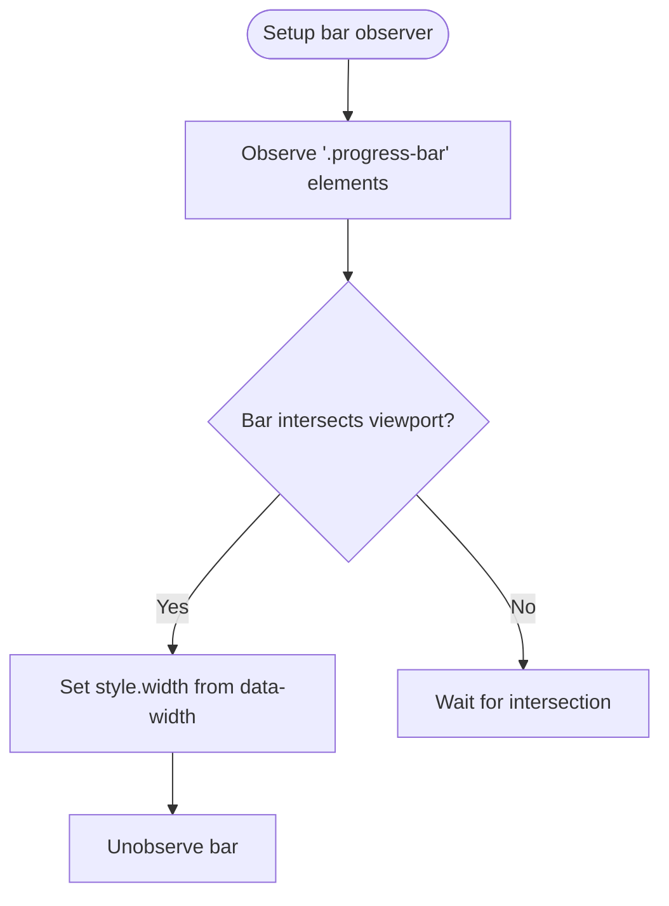

**Diagram sources**
- [script.js:139-151](file://js/script.js#L139-L151)
- [index.html:251-253](file://index.html#L251-L253)
- [index.html:265-267](file://index.html#L265-L267)
- [index.html:279-281](file://index.html#L279-L281)
- [index.html:293-295](file://index.html#L293-L295)
- [index.html:307-309](file://index.html#L307-L309)
- [index.html:321-323](file://index.html#L321-L323)

**Section sources**
- [script.js:139-151](file://js/script.js#L139-L151)
- [index.html:251-253](file://index.html#L251-L253)
- [index.html:265-267](file://index.html#L265-L267)
- [index.html:279-281](file://index.html#L279-L281)
- [index.html:293-295](file://index.html#L293-L295)
- [index.html:307-309](file://index.html#L307-L309)
- [index.html:321-323](file://index.html#L321-L323)

### Animated Statistics Counters
Responsibilities:
- Count numbers up smoothly when the stat elements become visible.
- Support optional suffixes and easing.

Implementation highlights:
- Uses `requestAnimationFrame` for smooth frame-based animation.
- Applies an ease-out quadratic curve for natural motion.
- Triggers via `IntersectionObserver` with a higher threshold to ensure visibility before counting.

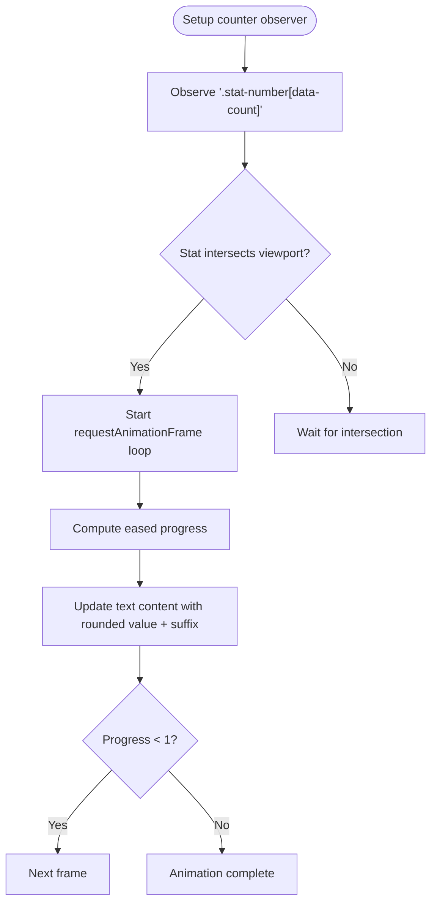

**Diagram sources**
- [script.js:159-189](file://js/script.js#L159-L189)
- [index.html:208-218](file://index.html#L208-L218)

**Section sources**
- [script.js:159-189](file://js/script.js#L159-L189)
- [index.html:208-218](file://index.html#L208-L218)

### Typing Animation Effect
Responsibilities:
- Cycle through a list of roles, typing and deleting each one.
- Respect user preferences for reduced motion.

Implementation highlights:
- Uses `setTimeout` recursion to control typing, deleting, and holding phases.
- Checks `prefers-reduced-motion` to skip animation and show static text.
- Updates text content directly for simplicity.

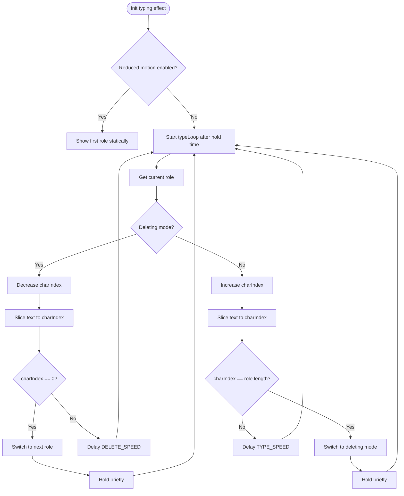

**Diagram sources**
- [script.js:195-241](file://js/script.js#L195-L241)
- [index.html:74-76](file://index.html#L74-L76)

**Section sources**
- [script.js:195-241](file://js/script.js#L195-L241)
- [index.html:74-76](file://index.html#L74-L76)

### Back-to-Top Button
Responsibilities:
- Smoothly scroll to the top of the page when clicked.

Implementation highlights:
- Uses `window.scrollTo` with smooth behavior.
- Visibility is controlled by the sticky header logic.

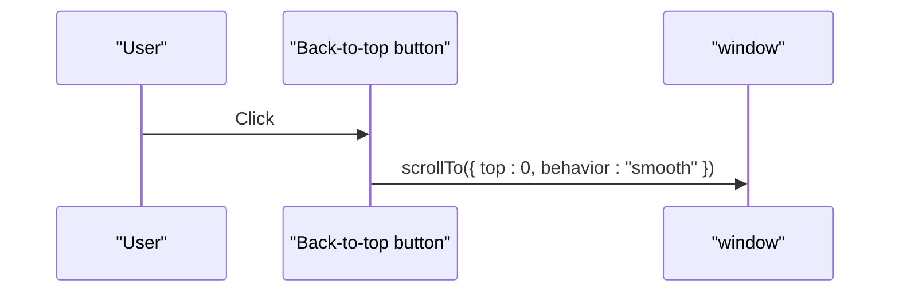

**Diagram sources**
- [script.js:351-353](file://js/script.js#L351-L353)
- [index.html:532-534](file://index.html#L532-L534)

**Section sources**
- [script.js:351-353](file://js/script.js#L351-L353)
- [index.html:532-534](file://index.html#L532-L534)

### Contact Form Validation
Responsibilities:
- Validate fields on blur and during input.
- Prevent default submission.
- Simulate sending and provide accessible status messages.
- Focus the first invalid field for keyboard users.

Implementation highlights:
- Field configuration object maps inputs, error elements, and validation rules.
- Uses regex for email validation.
- Updates ARIA attributes for invalid fields.
- Clears errors and resets the form after simulated success.

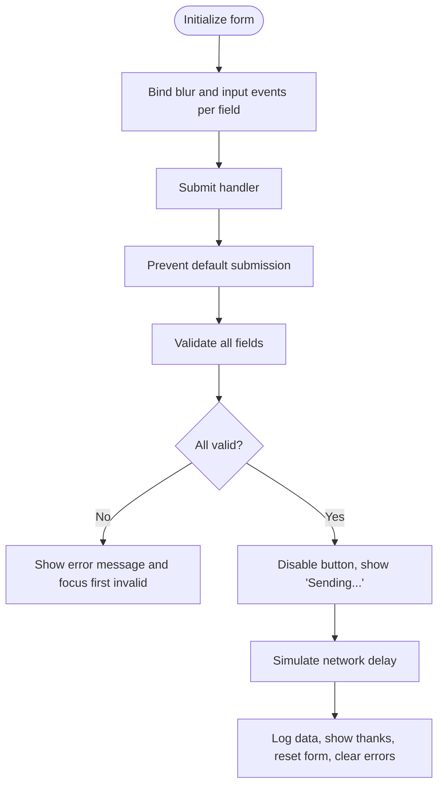

**Diagram sources**
- [script.js:249-346](file://js/script.js#L249-L346)
- [index.html:475-508](file://index.html#L475-L508)

**Section sources**
- [script.js:249-346](file://js/script.js#L249-L346)
- [index.html:475-508](file://index.html#L475-L508)

### Mouse-Follow Glow Effect
Responsibilities:
- Create a decorative radial gradient element that follows the cursor on desktop.
- Skip this effect on touch devices or for users who prefer reduced motion.

Implementation highlights:
- Detects hover capability and pointer type using `matchMedia`.
- Dynamically creates and appends a glow element.
- Updates position on mousemove and hides on mouseleave.

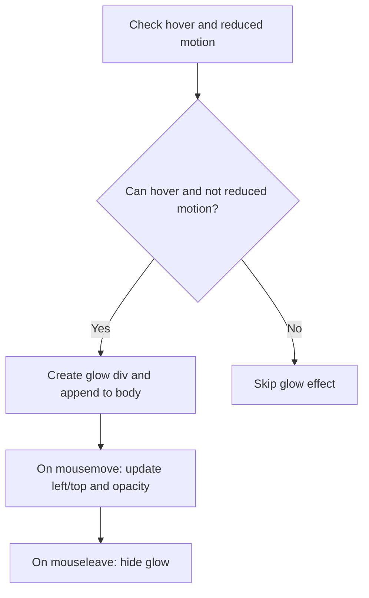

**Diagram sources**
- [script.js:365-386](file://js/script.js#L365-L386)

**Section sources**
- [script.js:365-386](file://js/script.js#L365-L386)

## Dependency Analysis
The script depends on:

- DOM elements defined in `index.html` with specific IDs and classes.
- CSS classes for visual states such as `.is-open`, `.is-visible`, `.is-scrolled`, `.is-invalid`.
- Modern browser APIs:
  - `IntersectionObserver` for efficient scroll detection.
  - `requestAnimationFrame` for smooth animations.
  - `matchMedia` for feature and preference detection.
  - `window.scrollTo` for smooth scrolling.
  - `addEventListener` with options like `{ passive: true }`.

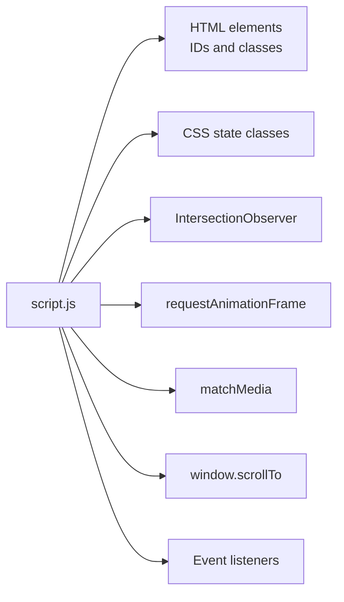

**Diagram sources**
- [script.js:1-388](file://js/script.js#L1-L388)
- [index.html:26-537](file://index.html#L26-L537)

**Section sources**
- [script.js:1-388](file://js/script.js#L1-L388)
- [index.html:26-537](file://index.html#L26-L537)

## Performance Considerations
- Use `IntersectionObserver` instead of scroll event calculations for detecting visibility.
- Attach passive scroll listeners to avoid blocking the main thread.
- Use `requestAnimationFrame` for frame-based animations like counters.
- Toggle CSS classes rather than repeatedly computing styles.
- Unobserve elements after animations to reduce observer overhead.
- Respect `prefers-reduced-motion` to disable animations for users who need it.
- Avoid heavy DOM queries inside tight loops; cache selectors where possible.
- Keep event listeners minimal and scoped to necessary elements.

[No sources needed since this section provides general guidance]

## Troubleshooting Guide
Common issues and resolutions:

- Menu does not close:
  - Ensure the toggle button has the correct ID and that the menu has the expected ID.
  - Verify that ARIA attributes are updated correctly when toggling.
  - Check that Escape key and outside-click listeners are attached.

- Active nav link not updating:
  - Confirm that sections have IDs matching nav link hrefs.
  - Verify that `main section[id]` selector matches the intended elements.
  - Inspect `IntersectionObserver` thresholds and margins.

- Reveal animations not triggering:
  - Ensure elements have the reveal class.
  - Check that the observer is created and elements are observed.
  - Verify CSS defines the visibility transition.

- Skill bars not animating:
  - Confirm elements have the progress bar class and `data-width`.
  - Check that the observer threshold allows bars to be detected.

- Counters not counting:
  - Ensure elements have the stat number class and `data-count`.
  - Verify the observer threshold is sufficient for visibility.

- Typing effect not working:
  - Check that the typed text element exists.
  - Confirm reduced motion settings are not preventing animation.

- Form validation errors:
  - Verify field IDs match the configuration object.
  - Ensure error span elements exist for each field.
  - Check that the form has the expected ID and submit button.

- Back-to-top button not appearing:
  - Confirm the button ID exists.
  - Check that the scroll listener runs and toggles the visibility class.

**Section sources**
- [script.js:39-81](file://js/script.js#L39-L81)
- [script.js:88-112](file://js/script.js#L88-L112)
- [script.js:119-131](file://js/script.js#L119-L131)
- [script.js:139-151](file://js/script.js#L139-L151)
- [script.js:159-189](file://js/script.js#L159-L189)
- [script.js:195-241](file://js/script.js#L195-L241)
- [script.js:249-346](file://js/script.js#L249-L346)
- [script.js:351-353](file://js/script.js#L351-L353)

## Conclusion
The portfolio’s JavaScript is a well-structured, modular, and performant implementation built entirely with vanilla JavaScript. It leverages modern APIs to deliver smooth interactions while maintaining accessibility and respecting user preferences. The IIFE pattern keeps the global namespace clean, and the separation of concerns makes it straightforward to extend the site with new features or integrate external services.

[No sources needed since this section summarizes without analyzing specific files]

## Appendices

### How to Extend the Functionality
- Add a new reveal animation:
  - Add the reveal class to the new element in the HTML.
  - No additional JS is required; the existing observer will handle it.

- Add a new animated statistic:
  - Add a stat number element with `data-count` and optionally `data-suffix`.
  - The existing observer will animate it automatically.

- Add a new skill bar:
  - Add a progress bar element with `data-width`.
  - The existing observer will animate it automatically.

- Add a new typing role:
  - Extend the roles array in the typing effect module.
  - Adjust timing constants if needed.

- Add a new form field:
  - Add the input and error span in the HTML.
  - Add a field entry in the form configuration object with a validate function.
  - Update the submit flow if needed.

- Integrate with an external service:
  - Replace the simulated send in the form submit handler with a `fetch` call.
  - Handle success and error responses, updating status messages accordingly.
  - Consider loading states, retries, and error boundaries.

**Section sources**
- [script.js:119-131](file://js/script.js#L119-L131)
- [script.js:159-189](file://js/script.js#L159-L189)
- [script.js:139-151](file://js/script.js#L139-L151)
- [script.js:195-241](file://js/script.js#L195-L241)
- [script.js:249-346](file://js/script.js#L249-L346)