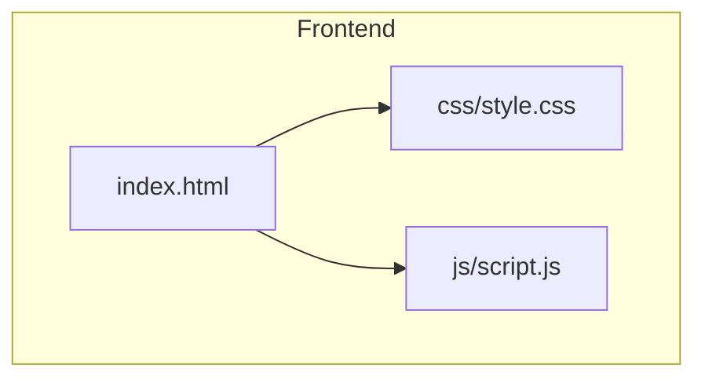
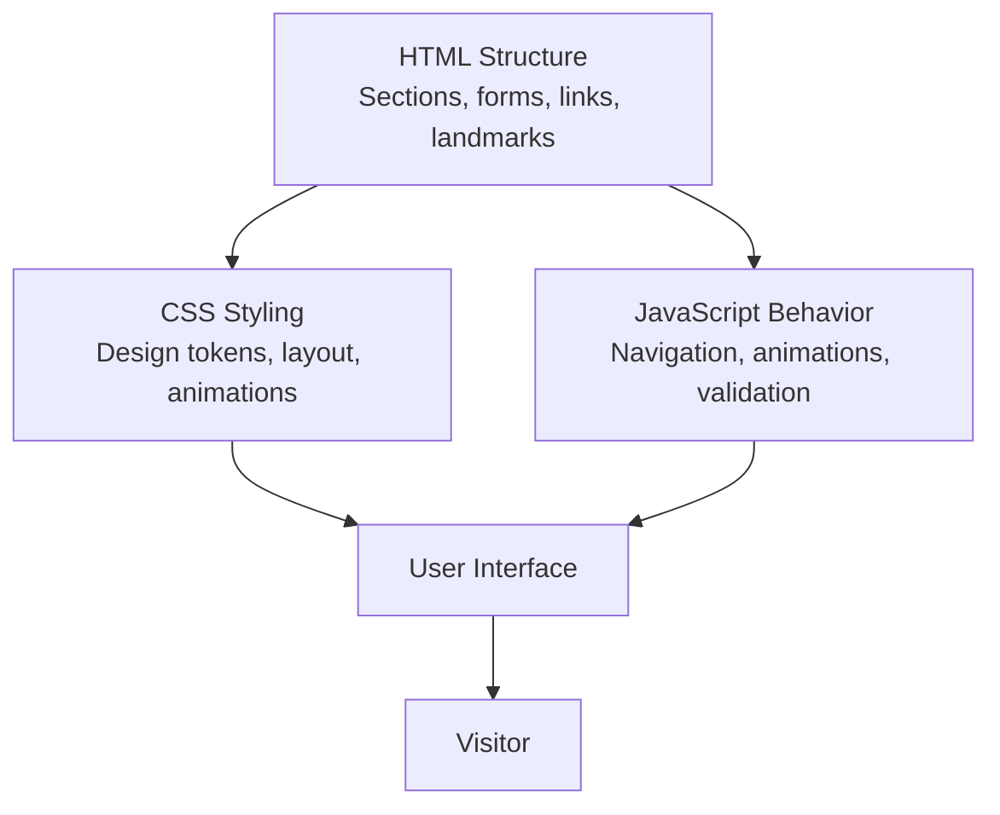
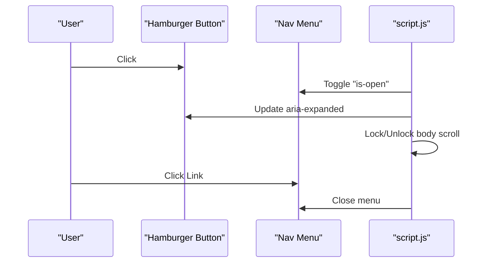
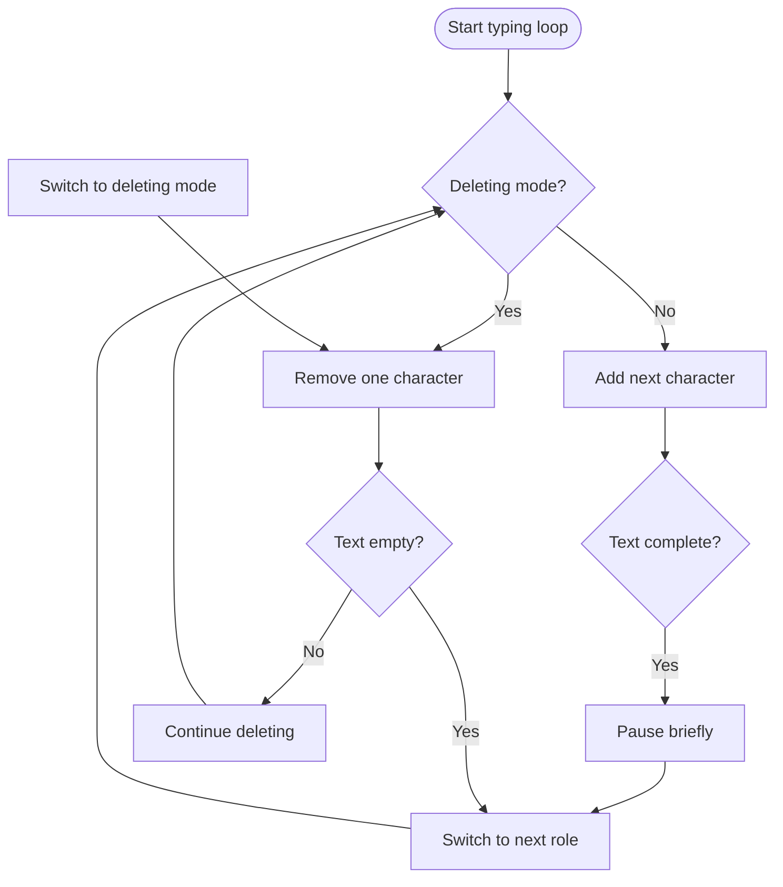
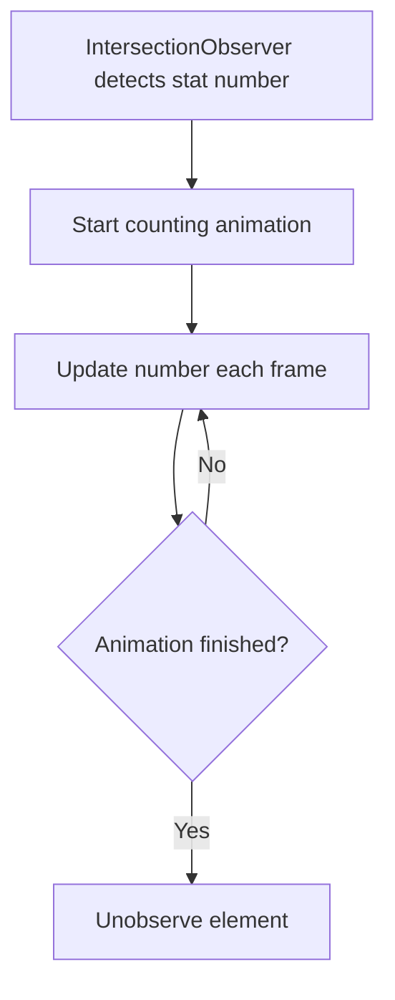
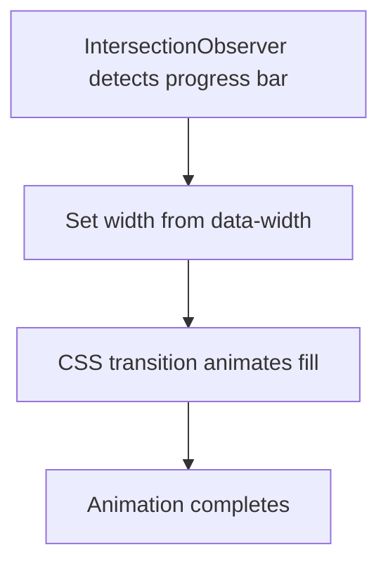
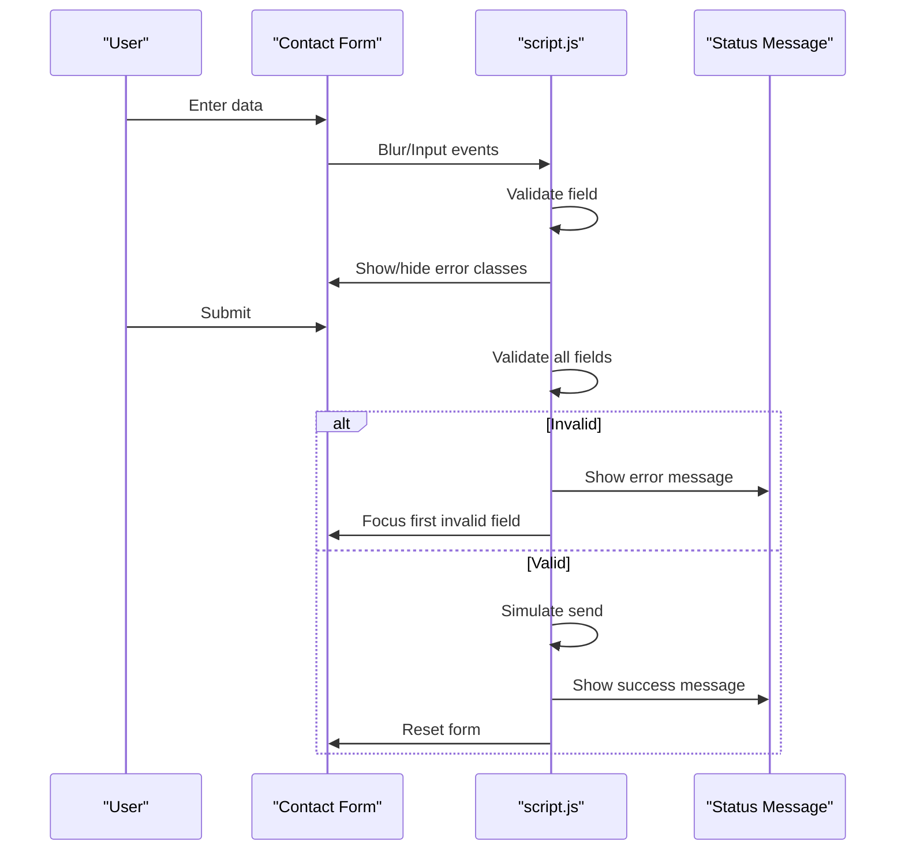
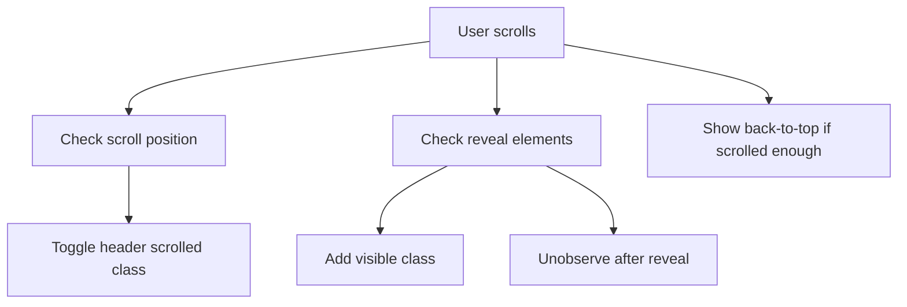
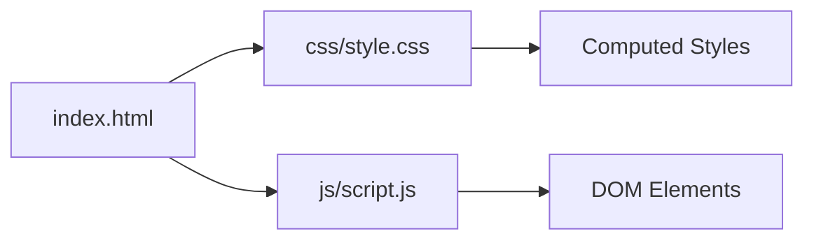

# Project Overview

<cite>
**Referenced Files in This Document**
- [index.html](file://index.html)
- [style.css](file://css/style.css)
- [script.js](file://js/script.js)
</cite>

## Table of Contents
1. [Introduction](#introduction)
2. [Project Structure](#project-structure)
3. [Core Components](#core-components)
4. [Architecture Overview](#architecture-overview)
5. [Detailed Component Analysis](#detailed-component-analysis)
6. [Dependency Analysis](#dependency-analysis)
7. [Performance Considerations](#performance-considerations)
8. [Troubleshooting Guide](#troubleshooting-guide)
9. [Conclusion](#conclusion)

## Introduction
This project is a professional portfolio website for Alex Morgan, a front-end developer based in Berlin. The site showcases skills, projects, and contact information using modern web development practices. It is built entirely with HTML5, CSS3, and vanilla JavaScript, without external frameworks or libraries.

The portfolio emphasizes:
- Semantic markup and accessibility
- Mobile-first responsive design
- Smooth animations and interactions
- Performance-conscious implementation
- Clean, maintainable code structure

It is suitable as both a learning example for beginners and a reference implementation for experienced developers who want to see practical use of core web technologies.

## Project Structure
The repository follows a simple, conventional layout:
- `index.html` — the main page containing all sections (header, hero, about, skills, projects, contact, footer)
- `css/style.css` — all styles, including design tokens, base styles, component styles, animations, and responsive rules
- `js/script.js` — all interactive behavior, including navigation, scroll effects, typing animation, counters, skill bars, form validation, and back-to-top functionality

**Diagram sources**
- [index.html:1-18](file://index.html#L1-L18)
- [index.html:536-538](file://index.html#L536-L538)

**Section sources**
- [index.html:1-18](file://index.html#L1-L18)
- [index.html:536-538](file://index.html#L536-L538)

## Core Components
This portfolio includes several key components that together create a polished user experience:

- Responsive navigation with mobile hamburger menu
- Hero section with typing animation and gradient text
- Animated statistics counters
- Skills showcase with animated progress bars
- Projects gallery with cards and tags
- Contact form with client-side validation
- Scroll-triggered reveal animations
- Back-to-top button
- Sticky header with glassy background on scroll

These features are implemented using semantic HTML elements, accessible attributes, CSS custom properties, and efficient JavaScript APIs such as IntersectionObserver and requestAnimationFrame.

**Section sources**
- [index.html:26-50](file://index.html#L26-L50)
- [index.html:57-151](file://index.html#L57-L151)
- [index.html:156-226](file://index.html#L156-L226)
- [index.html:231-327](file://index.html#L231-L327)
- [index.html:332-420](file://index.html#L332-L420)
- [index.html:425-511](file://index.html#L425-L511)
- [index.html:517-534](file://index.html#L517-L534)
- [script.js:21-34](file://js/script.js#L21-L34)
- [script.js:39-81](file://js/script.js#L39-L81)
- [script.js:119-131](file://js/script.js#L119-L131)
- [script.js:139-151](file://js/script.js#L139-L151)
- [script.js:159-189](file://js/script.js#L159-L189)
- [script.js:195-241](file://js/script.js#L195-L241)
- [script.js:249-346](file://js/script.js#L249-L346)
- [script.js:351-353](file://js/script.js#L351-L353)

## Architecture Overview
At a high level, the application consists of three layers:
- Presentation layer: HTML structure and CSS styling
- Interaction layer: Vanilla JavaScript handling events, animations, and state changes
- Content layer: Static content describing Alex Morgan’s profile, skills, projects, and contact details

[No diagram sources needed since this diagram shows conceptual architecture, not direct file mappings]

## Detailed Component Analysis

### Navigation and Header
The header provides a sticky navigation bar that becomes translucent when scrolled. On small screens, it switches to a hamburger menu with keyboard support and proper ARIA attributes.

Key behaviors:
- Adds a glassy background class after scrolling
- Toggles mobile menu open/close
- Updates ARIA attributes for screen readers
- Closes menu on link click, Escape key, outside click, or resize to desktop width
- Highlights the active section while scrolling using IntersectionObserver

**Diagram sources**
- [index.html:26-50](file://index.html#L26-L50)
- [script.js:39-81](file://js/script.js#L39-L81)

**Section sources**
- [index.html:26-50](file://index.html#L26-L50)
- [script.js:21-34](file://js/script.js#L21-L34)
- [script.js:39-81](file://js/script.js#L39-L81)
- [script.js:88-112](file://js/script.js#L88-L112)

### Hero Section and Typing Animation
The hero introduces Alex Morgan, highlights availability, and includes a typing effect that cycles through roles. The visual side uses pure CSS gradients and transforms instead of images.

Key behaviors:
- Types and deletes role phrases
- Respects reduced-motion preferences
- Uses a blinking cursor style
- Provides social links with accessible labels

**Diagram sources**
- [script.js:195-241](file://js/script.js#L195-L241)
- [index.html:69-76](file://index.html#L69-L76)

**Section sources**
- [index.html:57-151](file://index.html#L57-L151)
- [script.js:195-241](file://js/script.js#L195-L241)

### About Section and Animated Counters
The about section presents personal information and displays animated statistics. Numbers count up when they enter the viewport.

Key behaviors:
- Counts from zero to target value
- Uses easing for smooth animation
- Triggers only once per element
- Supports suffixes like plus signs and percentages

**Diagram sources**
- [script.js:159-189](file://js/script.js#L159-L189)
- [index.html:205-224](file://index.html#L205-L224)

**Section sources**
- [index.html:156-226](file://index.html#L156-L226)
- [script.js:159-189](file://js/script.js#L159-L189)

### Skills Showcase with Progress Bars
The skills section lists technical abilities with descriptive text and animated progress bars. Each bar animates its width when visible.

Key behaviors:
- Reads percentage from data attributes
- Animates width via CSS transitions
- Triggers once per bar
- Includes accessible progressbar roles and values

**Diagram sources**
- [script.js:139-151](file://js/script.js#L139-L151)
- [index.html:241-325](file://index.html#L241-L325)

**Section sources**
- [index.html:231-327](file://index.html#L231-L327)
- [script.js:139-151](file://js/script.js#L139-L151)

### Projects Gallery
The projects section displays project cards with titles, descriptions, technology tags, and links. Cards use reveal animations and hover effects.

Key characteristics:
- Semantic article elements for each project
- Accessible icons and decorative elements marked appropriately
- Links for live demos and source code
- Responsive grid layout

**Section sources**
- [index.html:332-420](file://index.html#L332-L420)

### Contact Form with Validation
The contact form collects name, email, subject, and message. It performs client-side validation and simulates submission.

Key behaviors:
- Validates fields on blur and input
- Shows inline error messages
- Sets ARIA invalid states
- Prevents default submission
- Simulates sending and resets the form
- Focus management for accessibility

**Diagram sources**
- [index.html:475-508](file://index.html#L475-L508)
- [script.js:249-346](file://js/script.js#L249-L346)

**Section sources**
- [index.html:425-511](file://index.html#L425-L511)
- [script.js:249-346](file://js/script.js#L249-L346)

### Scroll-Triggered Animations and Back-to-Top
Elements with the reveal class fade in when entering the viewport. A back-to-top button appears after scrolling down and smoothly scrolls to the top.

Key behaviors:
- Uses IntersectionObserver for performance
- Unobserves elements after revealing
- Smooth scroll behavior for back-to-top
- Sticky header updates on scroll

**Diagram sources**
- [script.js:21-34](file://js/script.js#L21-L34)
- [script.js:119-131](file://js/script.js#L119-L131)
- [script.js:351-353](file://js/script.js#L351-L353)

**Section sources**
- [script.js:21-34](file://js/script.js#L21-L34)
- [script.js:119-131](file://js/script.js#L119-L131)
- [script.js:351-353](file://js/script.js#L351-L353)

## Dependency Analysis
The project has minimal dependencies:
- HTML depends on CSS and JavaScript files
- CSS defines reusable design tokens and component styles
- JavaScript manipulates DOM elements identified by IDs and classes

**Diagram sources**
- [index.html:14-15](file://index.html#L14-L15)
- [index.html:536-538](file://index.html#L536-L538)

**Section sources**
- [index.html:14-15](file://index.html#L14-L15)
- [index.html:536-538](file://index.html#L536-L538)

## Performance Considerations
The project demonstrates several performance-friendly techniques:
- Passive scroll listeners for smoother scrolling
- IntersectionObserver instead of continuous scroll checks
- requestAnimationFrame for smooth number animations
- CSS transitions for lightweight animations
- Inline SVG icons to avoid extra network requests
- No external frameworks or heavy libraries
- Reduced-motion media query respected for animations

Best practices demonstrated:
- Avoid layout thrashing by batching DOM reads/writes
- Use semantic elements for better SEO and accessibility
- Keep animations subtle and purposeful
- Prefer CSS over JavaScript where possible

[No sources needed since this section provides general guidance]

## Troubleshooting Guide
Common issues and how to address them:

- Mobile menu does not close:
  - Ensure the toggle button has the correct ID and ARIA attributes
  - Verify event listeners for clicks, Escape key, and outside clicks
  - Check that resizing to desktop width resets the menu state

- Typing animation not appearing:
  - Confirm the typed text element exists
  - Check reduced-motion preference; animation may be disabled intentionally
  - Verify no console errors preventing script execution

- Skill bars not animating:
  - Ensure progress bars have data-width attributes
  - Confirm IntersectionObserver is observing the correct elements
  - Check that CSS transitions are applied to the progress bar class

- Counter numbers not animating:
  - Verify stat numbers have data-count attributes
  - Ensure the observer threshold allows visibility detection
  - Check that elements are within the viewport

- Form validation not working:
  - Confirm form has the expected ID and inputs exist
  - Check that error containers are present for each field
  - Verify ARIA-invalid attributes update correctly
  - Ensure submit event prevents default page reload

- Back-to-top button not visible:
  - Confirm the button has the correct ID
  - Check that scroll position exceeds the visibility threshold
  - Verify CSS class toggling adds the visible state

**Section sources**
- [script.js:39-81](file://js/script.js#L39-L81)
- [script.js:139-151](file://js/script.js#L139-L151)
- [script.js:159-189](file://js/script.js#L159-L189)
- [script.js:195-241](file://js/script.js#L195-L241)
- [script.js:249-346](file://js/script.js#L249-L346)
- [script.js:351-353](file://js/script.js#L351-L353)

## Conclusion
This portfolio website is a clean, accessible, and performant demonstration of modern front-end development using only HTML, CSS, and JavaScript. It balances visual appeal with usability, providing responsive navigation, engaging animations, and robust form validation. The codebase is well-structured and serves as a strong foundation for further customization or expansion.

For beginners, it offers clear examples of semantic markup, CSS variables, and vanilla JavaScript patterns. For experienced developers, it demonstrates thoughtful use of performance-oriented APIs, accessibility attributes, and maintainable styling strategies.

[No sources needed since this section summarizes without analyzing specific files]