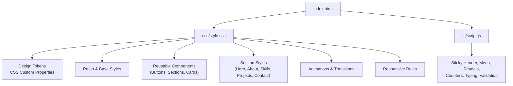
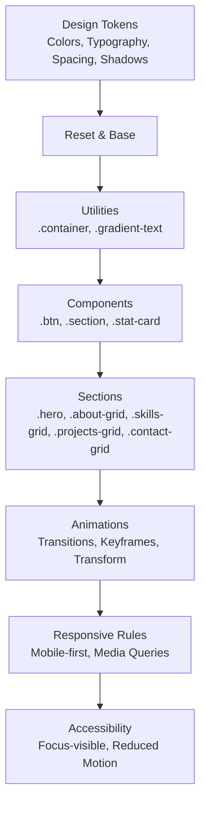
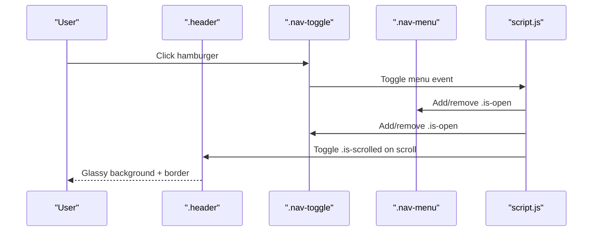
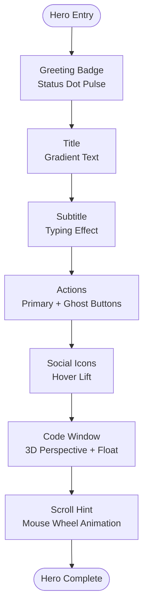
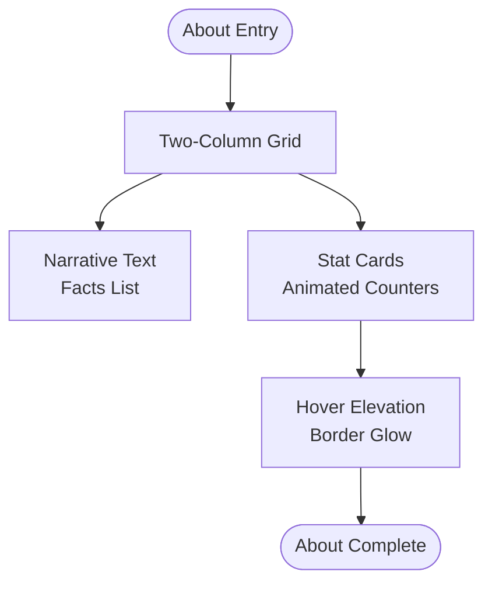
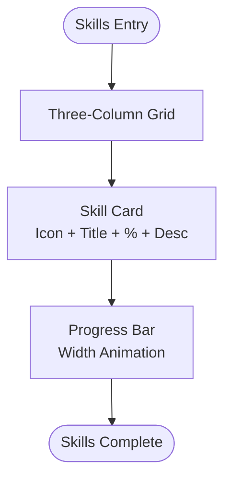
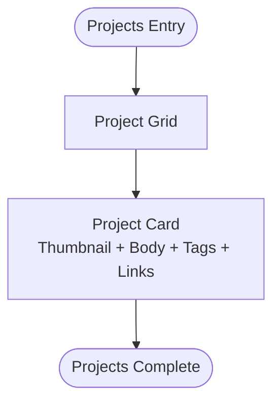
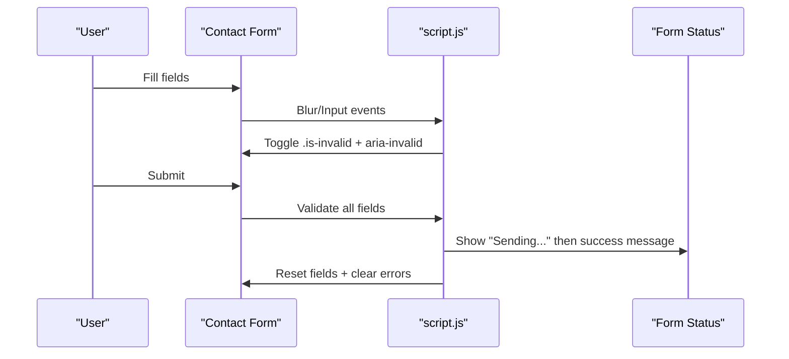
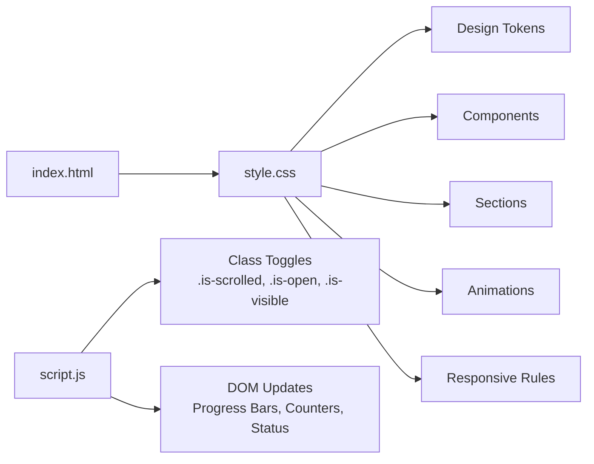

# Styling System

<cite>
**Referenced Files in This Document**
- [style.css](file://css/style.css)
- [index.html](file://index.html)
- [script.js](file://js/script.js)
</cite>

## Table of Contents
1. [Introduction](#introduction)
2. [Project Structure](#project-structure)
3. [Core Components](#core-components)
4. [Architecture Overview](#architecture-overview)
5. [Detailed Component Analysis](#detailed-component-analysis)
6. [Dependency Analysis](#dependency-analysis)
7. [Performance Considerations](#performance-considerations)
8. [Troubleshooting Guide](#troubleshooting-guide)
9. [Conclusion](#conclusion)
10. [Appendices](#appendices)

## Introduction
This document explains the styling system for the portfolio website. It focuses on how CSS is organized, how design tokens are defined and used, how responsive layouts work, how components are styled, and how animations are implemented. It also provides guidance for customizing the theme, adding new components consistently, and maintaining cross-browser compatibility and performance.

The site uses a single main stylesheet that follows a clear top-to-bottom order: design tokens, reset and base styles, reusable pieces, section components, animations, responsive rules, and accessibility helpers. The HTML structure defines semantic sections such as header, hero, about, skills, projects, contact, and footer. JavaScript adds interactivity like a sticky header, mobile menu, scroll-based reveals, skill bar animations, number counters, typing effects, form validation, and back-to-top behavior.

## Project Structure
The project has a minimal but effective structure:
- `index.html` contains the page markup and links to the stylesheet and script.
- `css/style.css` contains all styling, including design tokens, layout, components, animations, and responsive rules.
- `js/script.js` handles user interactions and dynamic behaviors.

**Diagram sources**
- [index.html:14-15](file://index.html#L14-L15)
- [index.html:21-537](file://index.html#L21-L537)
- [style.css:20-18](file://css/style.css#L20-L18)

**Section sources**
- [index.html:1-540](file://index.html#L1-L540)
- [style.css:1-1508](file://css/style.css#L1-L1508)
- [script.js:1-388](file://js/script.js#L1-L388)

## Core Components
The styling system is built around reusable patterns:
- Design tokens define colors, typography, spacing, shape, depth, gradients, and motion.
- Base styles normalize defaults and set global behavior.
- Reusable components include buttons, section headings, containers, and utility classes.
- Section components style each major area of the page.
- Animation utilities provide transitions, keyframes, and transform-driven effects.

Key component categories:
- Buttons: primary, ghost, outline, small, block, disabled states.
- Section wrappers: section padding, alternating backgrounds, centered headings.
- Cards: stat cards with gradient accents and hover elevation.
- Skill cards: icon, title, percentage, description, progress bar.
- Project cards: thumbnail, body, tags, links.
- Contact form fields: labels, inputs, error messages, submit button.

**Section sources**
- [style.css:25-73](file://css/style.css#L25-L73)
- [style.css:170-316](file://css/style.css#L170-L316)
- [style.css:321-445](file://css/style.css#L321-L445)
- [style.css:450-684](file://css/style.css#L450-L684)
- [style.css:689-788](file://css/style.css#L689-L788)
- [style.css:793-800](file://css/style.css#L793-L800)

## Architecture Overview
The CSS architecture follows a layered approach:
- Layer 1: Design tokens (custom properties).
- Layer 2: Reset and base styles.
- Layer 3: Reusable components and utilities.
- Layer 4: Section-specific styles.
- Layer 5: Animations and transitions.
- Layer 6: Responsive breakpoints and mobile-first adjustments.
- Layer 7: Accessibility and reduced-motion preferences.

**Diagram sources**
- [style.css:20-18](file://css/style.css#L20-L18)
- [style.css:25-73](file://css/style.css#L25-L73)
- [style.css:75-168](file://css/style.css#L75-L168)
- [style.css:170-316](file://css/style.css#L170-L316)
- [style.css:318-684](file://css/style.css#L318-L684)
- [style.css:689-788](file://css/style.css#L689-L788)

## Detailed Component Analysis

### Design Tokens and Theme Customization
Design tokens are defined as CSS custom properties under `:root`. They centralize:
- Backgrounds: dark palette from darkest to lightest surfaces.
- Text: primary, muted, and dim variants.
- Brand colors: primary, accent, pink, success, danger, warning.
- Gradients: background, soft, and text gradients.
- Shape and depth: radius scale and shadow tokens.
- Typography: font families for body and headings.
- Layout: container width and header height.
- Motion: easing curve and speed variables.

To customize the theme:
- Change brand colors by updating `--primary`, `--accent`, and related tokens.
- Adjust surface and border opacity to alter contrast.
- Modify gradients to shift the visual tone.
- Update typography tokens to switch fonts or adjust weights.
- Tweak spacing and radius to change the overall feel.

Example customization paths:
- Colors and gradients: [style.css:25-52](file://css/style.css#L25-L52)
- Typography and layout tokens: [style.css:62-68](file://css/style.css#L62-L68)
- Motion tokens: [style.css:70-73](file://css/style.css#L70-L73)

**Section sources**
- [style.css:25-73](file://css/style.css#L25-L73)

### Reset and Base Styles
Base styles establish consistent defaults:
- Box-sizing normalization across elements.
- Smooth scrolling and scroll-padding for fixed headers.
- Body background, text color, font family, line-height, and antialiasing.
- Image and SVG sizing constraints.
- Link and button resets to inherit theme.
- Heading styles using heading font family and tight letter-spacing.
- Focus-visible outlines for keyboard navigation.
- Selection color customization.

These rules ensure predictable rendering and accessibility foundations.

**Section sources**
- [style.css:75-168](file://css/style.css#L75-L168)

### Reusable Components and Utilities
Reusable components provide consistent UI building blocks:
- Container centers content and applies side padding.
- Gradient text utility applies animated gradient coloring.
- Button base class includes flex layout, rounded corners, transitions, and hover/active states.
- Button variants:
  - Primary: gradient fill with glow shadow.
  - Ghost: subtle glass-like background with border.
  - Outline: tinted border and background.
  - Small size modifier.
  - Block modifier for full-width usage.
  - Disabled state with reduced opacity and no interaction.
- Section wrapper provides vertical padding and z-index layering.
- Alternating section background improves visual separation.
- Section head styles center and space headings and subtitles.
- Eyebrow badge highlights section labels with accent color and border.

These patterns make it easy to compose pages while maintaining consistency.

**Section sources**
- [style.css:170-316](file://css/style.css#L170-L316)

### Header and Navigation
The header is fixed at the top and becomes translucent with backdrop blur after scrolling. Navigation includes:
- Logo with accent dot.
- Horizontal menu with hover and active underline animation.
- Hamburger toggle for mobile, morphing into an X when open.
- JavaScript toggles `.is-open` and `.is-scrolled` classes based on user actions and scroll position.

**Diagram sources**
- [style.css:321-445](file://css/style.css#L321-L445)
- [script.js:21-34](file://js/script.js#L21-L34)
- [script.js:39-81](file://js/script.js#L39-L81)

**Section sources**
- [style.css:321-445](file://css/style.css#L321-L445)
- [script.js:21-81](file://js/script.js#L21-L81)

### Hero Section
The hero introduces the developer with:
- Greeting badge with pulsing availability dot.
- Title using gradient text.
- Subtitle with typing effect controlled by JavaScript.
- Description paragraph.
- Action buttons using primary and ghost variants.
- Social icons with hover lift and accent color.
- Decorative glowing circles with floating animations.
- Code window with 3D perspective and hover transforms.
- Scroll hint with mouse wheel animation.

**Diagram sources**
- [style.css:450-684](file://css/style.css#L450-L684)
- [script.js:195-241](file://js/script.js#L195-L241)

**Section sources**
- [style.css:450-684](file://css/style.css#L450-L684)
- [script.js:195-241](file://js/script.js#L195-L241)

### About Section
The about section combines narrative text with stat cards:
- Two-column grid layout.
- Facts list with icons.
- Stat cards with gradient top borders and hover elevation.
- Accent variant card for emphasis.
- Animated numbers counting up when visible.

**Diagram sources**
- [style.css:689-788](file://css/style.css#L689-L788)
- [script.js:159-189](file://js/script.js#L159-L189)

**Section sources**
- [style.css:689-788](file://css/style.css#L689-L788)
- [script.js:159-189](file://js/script.js#L159-L189)

### Skills Section
The skills section showcases technologies with progress bars:
- Three-column grid of skill cards.
- Each card includes icon, title, percentage, description, and progress bar.
- Progress bars animate their width when scrolled into view.

**Diagram sources**
- [style.css:793-800](file://css/style.css#L793-L800)
- [script.js:139-151](file://js/script.js#L139-L151)

**Section sources**
- [style.css:793-800](file://css/style.css#L793-L800)
- [script.js:139-151](file://js/script.js#L139-L151)

### Projects Section
The projects section displays project cards:
- Grid layout for multiple projects.
- Each card has a thumbnail placeholder, body with title, description, tags, and links.
- Links include live demo and source code options.

**Diagram sources**
- [index.html:342-418](file://index.html#L342-L418)

**Section sources**
- [index.html:342-418](file://index.html#L342-L418)

### Contact Section
The contact section provides information and a validated form:
- Contact info items with icons and labels.
- Form fields for name, email, subject, message.
- Inline error messages and invalid state styling.
- Submit button with block modifier.
- Status message updates on validation and submission.

**Diagram sources**
- [index.html:476-508](file://index.html#L476-L508)
- [script.js:249-345](file://js/script.js#L249-L345)

**Section sources**
- [index.html:476-508](file://index.html#L476-L508)
- [script.js:249-345](file://js/script.js#L249-L345)

### Footer and Back-to-Top
The footer includes logo, year, and links. The back-to-top button appears after scrolling and smoothly scrolls to the top.

**Section sources**
- [index.html:517-537](file://index.html#L517-L537)
- [script.js:351-353](file://js/script.js#L351-L353)

## Dependency Analysis
The styling system depends on:
- HTML structure for semantic sections and component classes.
- CSS custom properties for consistent theming.
- JavaScript for interactive behaviors that toggle classes and update DOM.

**Diagram sources**
- [index.html:14-15](file://index.html#L14-L15)
- [style.css:25-73](file://css/style.css#L25-L73)
- [script.js:21-34](file://js/script.js#L21-L34)
- [script.js:139-151](file://js/script.js#L139-L151)
- [script.js:159-189](file://js/script.js#L159-L189)

**Section sources**
- [index.html:1-540](file://index.html#L1-L540)
- [style.css:1-1508](file://css/style.css#L1-L1508)
- [script.js:1-388](file://js/script.js#L1-L388)

## Performance Considerations
- Use CSS custom properties to avoid repeated values and enable efficient theme changes.
- Prefer transforms and opacity for animations to leverage GPU acceleration.
- Limit heavy filters and large shadows; use them sparingly for decorative elements.
- Use `will-change` judiciously for elements that will animate frequently.
- Avoid layout thrashing by minimizing forced reflows; batch DOM reads/writes.
- Respect `prefers-reduced-motion` to disable unnecessary animations.
- Keep media queries simple and targeted to reduce parsing overhead.
- Use passive event listeners for scroll and touch events where possible.

[No sources needed since this section provides general guidance]

## Troubleshooting Guide
Common issues and resolutions:
- Header not becoming glassy: Ensure `.is-scrolled` is toggled correctly on scroll. Check scroll listener and threshold.
- Mobile menu not closing: Verify `.is-open` toggling on nav toggle and link clicks; ensure Escape key handler closes menu.
- Skill bars not animating: Confirm `.progress-bar` elements have `data-width` attributes and IntersectionObserver triggers.
- Numbers not counting: Ensure `.stat-number[data-count]` exists and observer threshold is appropriate.
- Typing effect not working: Check if `prefers-reduced-motion` is enabled; the effect is skipped for accessibility.
- Form validation errors not showing: Verify field IDs match error element IDs and `.is-invalid` toggling logic.

Relevant implementation references:
- Sticky header and back-to-top visibility: [script.js:21-34](file://js/script.js#L21-L34)
- Mobile menu toggle and close behaviors: [script.js:39-81](file://js/script.js#L39-L81)
- Skill bar animation: [script.js:139-151](file://js/script.js#L139-L151)
- Number counter animation: [script.js:159-189](file://js/script.js#L159-L189)
- Typing effect and reduced motion: [script.js:195-241](file://js/script.js#L195-L241)
- Form validation and status updates: [script.js:249-345](file://js/script.js#L249-L345)

**Section sources**
- [script.js:21-34](file://js/script.js#L21-L34)
- [script.js:39-81](file://js/script.js#L39-L81)
- [script.js:139-151](file://js/script.js#L139-L151)
- [script.js:159-189](file://js/script.js#L159-L189)
- [script.js:195-241](file://js/script.js#L195-L241)
- [script.js:249-345](file://js/script.js#L249-L345)

## Conclusion
The styling system is cohesive, token-driven, and component-oriented. It leverages CSS custom properties for theming, modular component classes for reuse, and JavaScript for lightweight interactivity. The mobile-first approach ensures responsiveness, while animations and transitions enhance user experience without compromising performance. By following the established patterns—design tokens, reusable components, and section layouts—you can extend the design system consistently and maintain accessibility and performance across browsers.

[No sources needed since this section summarizes without analyzing specific files]

## Appendices

### How to Customize the Theme
- Change brand colors: Update `--primary`, `--accent`, and related tokens in the root scope.
- Adjust gradients: Modify `--gradient`, `--gradient-soft`, and `--gradient-text`.
- Switch fonts: Update `--font-body` and `--font-heading`.
- Tune spacing and radius: Adjust `--radius-*` and container/header tokens.
- Refine motion: Edit `--ease` and `--speed`.

Reference locations:
- Root tokens: [style.css:25-73](file://css/style.css#L25-L73)

### How to Add New Components
- Define any new tokens in `:root` if they introduce new colors, sizes, or effects.
- Create a base class for common layout and transitions.
- Add variant classes for different appearances (e.g., primary, ghost, outline).
- Use existing section wrappers and container utilities for consistent spacing.
- If the component requires interaction, add class toggles via JavaScript similar to existing patterns.

Reference patterns:
- Button base and variants: [style.css:193-273](file://css/style.css#L193-L273)
- Section wrapper and headings: [style.css:275-316](file://css/style.css#L275-L316)
- Class toggling examples: [script.js:21-34](file://js/script.js#L21-L34), [script.js:39-81](file://js/script.js#L39-L81)

### Cross-Browser Compatibility Notes
- Use vendor prefixes where necessary for features like `background-clip`.
- Test backdrop-filter support on older browsers; degrade gracefully if unsupported.
- Validate modern CSS features like `clamp()` and `svh` units; provide fallbacks if targeting legacy environments.
- Ensure focus-visible outlines work across browsers; fall back to standard focus styles if needed.

Reference implementations:
- Gradient text with background-clip: [style.css:182-191](file://css/style.css#L182-L191)
- Fluid typography with clamp: [style.css:308-311](file://css/style.css#L308-L311)
- Viewport height unit svh: [style.css:450-457](file://css/style.css#L450-L457)